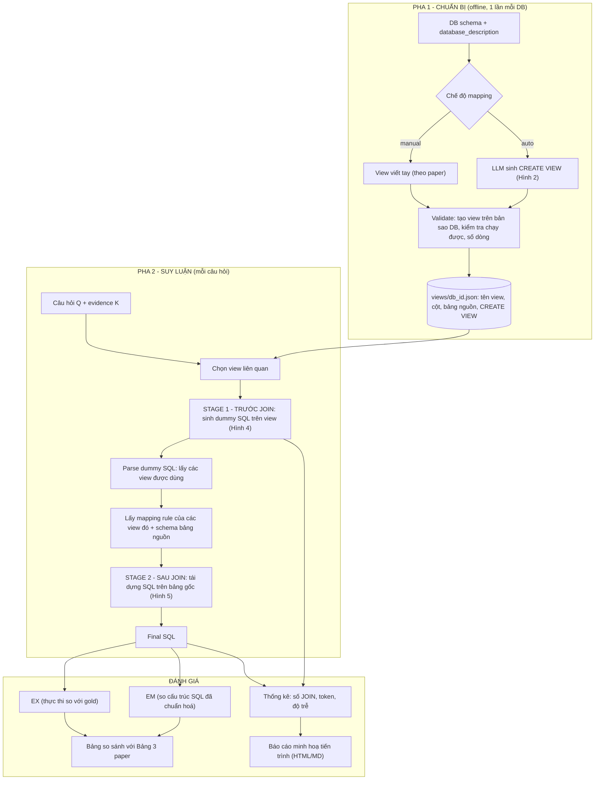
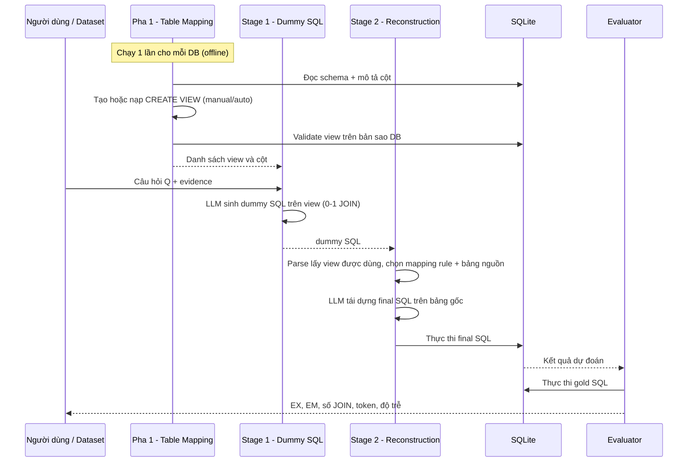
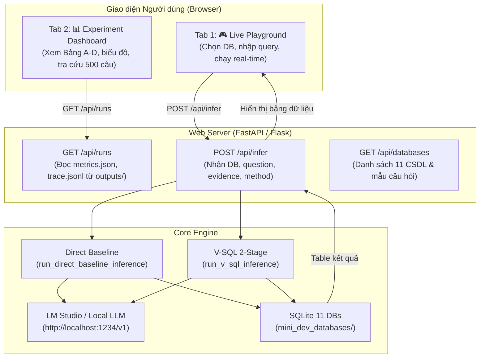

# V-SQL: Tái hiện & Mở rộng — Tài liệu Dự án Hoàn chỉnh

> **Paper chính:** *V-SQL: A View-based Two-stage Text-to-SQL Framework* (You et al., Huaweisoft, 2024) — `document/5.4`
> **Dataset:** BIRD mini-dev (500 câu, 11 CSDL) — <https://bird-bench.github.io/> · <https://github.com/bird-bench/mini_dev>
> **Mục tiêu:** Tái hiện đúng tinh thần paper, đo trên **dữ liệu gốc (toàn bộ 500 câu)**, so sánh kết quả của mình với kết quả paper bằng **EX** và **EM**, và **minh hoạ tiến trình chạy** của 2 pha.

---

## Mục lục

0. [Tóm tắt nhanh (TL;DR)](#0-tóm-tắt-nhanh-tldr)
1. [Phân tích paper chính V-SQL](#1-phân-tích-paper-chính-v-sql)
2. [Bối cảnh từ 4 paper cùng nhóm](#2-bối-cảnh-từ-4-paper-cùng-nhóm)
3. [Diễn giải nhận xét của giảng viên → yêu cầu cụ thể](#3-diễn-giải-nhận-xét-của-giảng-viên--yêu-cầu-cụ-thể)
4. [Phân tích hiện trạng code & những điểm còn thiếu](#4-phân-tích-hiện-trạng-code--những-điểm-còn-thiếu)
5. [Kiến trúc mục tiêu](#5-kiến-trúc-mục-tiêu)
6. [Thiết kế chi tiết từng module](#6-thiết-kế-chi-tiết-từng-module)
7. [Đánh giá: EX, EM và các chỉ số phụ](#7-đánh-giá-ex-em-và-các-chỉ-số-phụ)
8. [Thiết kế thực nghiệm & bảng so sánh với paper](#8-thiết-kế-thực-nghiệm--bảng-so-sánh-với-paper)
9. [Minh hoạ tiến trình chạy](#9-minh-hoạ-tiến-trình-chạy)
10. [Cấu trúc thư mục đề xuất](#10-cấu-trúc-thư-mục-đề-xuất)
11. [Lộ trình & checklist](#11-lộ-trình--checklist)
12. [Rủi ro, hạn chế & lưu ý khi viết báo cáo](#12-rủi-ro-hạn-chế--lưu-ý-khi-viết-báo-cáo)
13. [Phụ lục](#13-phụ-lục)
14. [Giai đoạn G8: Thiết kế Giao diện Web Interactive & Dashboard (Frontend)](#14-giai-đoạn-g8-thiết-kế-giao-diện-web-interactive--dashboard-frontend)

---

## 0. Tóm tắt nhanh (TL;DR)

| Hạng mục | Paper V-SQL | Dự án hiện tại | Cần làm |
|---|---|---|---|
| Dữ liệu | 500 câu / 11 DB (BIRD mini-dev) | **6 câu / 1 DB** (superhero), có 1 câu **trùng ID** | Tải đủ 11 DB, chạy đủ 500 câu |
| Table Mapping (Pha 1) | View **thiết kế thủ công** dựa trên JOIN trong gold SQL | LLM 4B tự sinh, **không kiểm tra** view có chạy được không | Hỗ trợ cả *manual* (đúng paper) và *auto* (mở rộng), có bước validate |
| View schema cho Stage 1 | Danh sách view + cột | **Bug**: chỉ lấy phần trước chữ `FROM` đầu tiên → mất hết view thứ 2 trở đi | Parse từng `CREATE VIEW` bằng `sqlglot` |
| Stage 2 (Reconstruction) | Chỉ đưa **mapping rule của view được dùng** + bảng liên quan (schema linking qua mapping rule) | Đưa **toàn bộ** rule + toàn bộ schema; prompt thiếu dấu đóng ```` ``` ```` | Trích view từ dummy SQL → chọn rule + bảng gốc tương ứng |
| Cấu hình LLM | temperature = 0, top-p = 1, max_tokens = 800 | temperature = **0.5** | Đưa về 0 / 1 / 800 |
| Chỉ số | EX theo SIM / MOD / CHALL | Chỉ EX; ghép dự đoán–gold **theo thứ tự**, không theo `question_id` | Sửa EX + **thêm EM** + thống kê số JOIN, token, độ trễ |
| So sánh | 3 baseline (DIN, DAIL, TA-SQL) với GPT-3.5/4/4-turbo | Không có | **Lấy số từ paper** (Bảng 3) + chạy 1 baseline *Direct* (không view) cùng mô hình |
| Minh hoạ | Hình 1, Bảng 4 | Chỉ in ra console | Lưu trace từng câu (JSON) + báo cáo HTML/Markdown + sơ đồ Mermaid |

---

## 1. Phân tích paper chính V-SQL

### 1.1 Vấn đề paper giải quyết

- Text-to-SQL bằng LLM thường chia thành 2 bước: **schema linking** (chọn bảng/cột liên quan) → **logical synthesis** (sinh SQL).
- LLM hay bị **schema-based hallucination**: gán nhầm cột cho bảng khi câu có JOIN. Ví dụ ở Bảng 1 của paper: LLM viết `hero_attribute.attribute_name`, trong khi `attribute_name` nằm ở bảng `attribute` → lỗi `no such column`.
- Giả thuyết của tác giả: **LLM không hiểu tốt quan hệ khoá ngoại (FK)** giữa các bảng. Schema càng đơn giản (WikiSQL) thì độ chính xác càng cao so với schema phức tạp (BIRD).

### 1.2 Ý tưởng cốt lõi: *view-based schema*

- Dùng **VIEW** để gộp các bảng có quan hệ FK thành một "bảng ảo" phẳng, bỏ đi các cột `*_id`.
  Ví dụ: `superhero.eye_colour_id → colour.colour` trở thành cột `v_superhero.eye_colour`.
- Công thức:
  - Text-to-SQL ICL thông thường: `y = f(x, I, S, D | θ)` (1); zero-shot: `y = f(x, I, D | θ)` (2)
  - V-SQL: `y = f(x, I, S, D' | θ)` (3), trong đó **D' là schema gồm các view**, thay cho D.
- **Quan trọng:** D' chỉ là **hướng dẫn trong prompt**. Paper ghi rõ là *không cần tạo view trong CSDL*.

### 1.3 Framework V-SQL — lấy cảm hứng từ autoencoder

| Thành phần | Vai trò | Ví dụ autoencoder | Đầu vào → Đầu ra |
|---|---|---|---|
| **(A) Table Mapping** | Biến bảng gốc D thành view D' (cú pháp `CREATE VIEW`) | — (chuẩn bị) | DB schema → mapping rules |
| **(B) Dummy SQL Generation** | Sinh SQL trên **view** (ngắn, ít/không JOIN) | *Encoder* (vector nén, "mật độ thông tin cao") | (Q, view schema) → dummy SQL |
| **(C) SQL Reconstruction** | Viết lại dummy SQL thành SQL trên **bảng gốc** | *Decoder* | (Q, dummy SQL, mapping rule liên quan, schema bảng liên quan) → final SQL |

Điểm tinh tế cần làm đúng:

1. **Dummy SQL không được thực thi** (mục 4.4). Lý do: truy vấn trên view là truy vấn trên một tập kết quả đã JOIN sẵn (LEFT JOIN có thể sinh NULL hoặc nhân dòng), nên dễ sai.
2. **Schema linking ở Stage 2 dựa trên mapping rule** (mục 4.5): dummy SQL dùng `v_superhero` → lấy rule của `v_superhero` → suy ra các bảng `superhero, gender, colour, publisher, …` → chỉ đưa các bảng này vào prompt. Mục đích là tránh nhiễu từ bảng không liên quan.
3. Hình 1(B) có khối **"Relevant Views"**, tức là ở Stage 1 chỉ đưa các view liên quan. Phần Discussion cũng nói khi số view tăng thì *khó truy xuất đúng view mô tả*, nên có một bước **chọn view** (view retrieval).
4. Dummy SQL ngắn hơn → **ít token output hơn** → nhanh hơn (mục 4.4). Đây là một tuyên bố **có thể đo được**.

### 1.4 Thiết lập thực nghiệm của paper

| Mục | Giá trị |
|---|---|
| Dataset | BIRD mini-dev: **500 câu, 11 DB**; SIM 148 / MOD 250 / CHALL 102 |
| Số JOIN trung bình (Bảng 2) | 0.75 / 1.16 / 1.35 |
| Số bảng trung bình mỗi SQL | 2.30 / 2.62 / 2.76 |
| Số loại tổ hợp bảng | 50 / 86 / 54 |
| Chỉ số | **Chỉ EX** (không báo cáo EM, VES) |
| Mô hình | gpt-3.5-turbo, gpt-4-32k, GPT-4-turbo |
| Siêu tham số | temperature = 0, top-p = 1, max_tokens = 800 |
| Baseline | DIN-SQL, DAIL-SQL, TA-SQL; **không dùng** self-consistency / self-correction |
| Cách tạo view | **Thủ công**, dựa trên các JOIN xuất hiện trong ground-truth SQL (mục 6) |

> Kiểm tra lại trên file `data/mini_dev_sqlite.json` của dự án: SIM 148 / MOD 250 / CHALL 102. Số JOIN trung bình (đếm bằng regex) là **0.68 / 1.14 / 1.39**, sát với Bảng 2 của paper. Phân bố câu theo DB: formula_1 66, superhero 52, card_games 52, european_football_2 51, thrombosis_prediction 50, codebase_community 49, student_club 48, toxicology 40, financial 32, debit_card_specializing 30, california_schools 30.

### 1.5 Kết quả paper (Bảng 3 — EX %, BIRD mini-dev)

| Model | Method | SIM | MOD | CHALL | TOTAL |
|---|---|---|---|---|---|
| GPT-4 | DIN-SQL | 63.51 | 43.60 | 32.35 | 47.20 |
| | DAIL-SQL | 66.89 | 44.40 | 34.31 | 49.00 |
| | TA-SQL | 62.83 | 60.40 | 36.11 | **56.17** |
| | **V-SQL** | 62.84 | 59.60 | 37.25 | 56.00 |
| GPT-4-turbo | DIN-SQL | 58.11 | 47.60 | 33.30 | 47.80 |
| | DAIL-SQL | 60.13 | 48.80 | 32.35 | 48.80 |
| | TA-SQL | 62.90 | 48.40 | 36.11 | 50.16 |
| | **V-SQL** | 62.16 | 51.60 | 40.19 | **52.80** |
| GPT-3.5-turbo | DIN-SQL | 49.32 | 39.60 | 23.52 | 39.20 |
| | DAIL-SQL | 52.03 | 43.60 | 23.52 | 42.00 |
| | TA-SQL | 56.75 | 42.80 | 27.45 | 43.80 |
| | **V-SQL** | 58.11 | 43.60 | 31.37 | **45.40** |

Nhận xét:
- V-SQL **mạnh nhất ở câu CHALLENGING** (nhiều JOIN nhất) với cả 3 mô hình. Điều này khớp với giả thuyết "giảm JOIN giúp giảm hallucination".
- Với GPT-4, TA-SQL nhỉnh hơn. Tác giả cho rằng mô hình càng mạnh thì schema linking trực tiếp càng tốt, nên lợi ích của view giảm. **Hệ quả cho dự án:** với mô hình nhỏ (Qwen3-4B), lợi ích của view **có thể lớn hơn**, và đây là một giả thuyết đáng kiểm chứng.

### 1.6 Case study (Bảng 4) — dùng làm ví dụ minh hoạ chuẩn

- Câu hỏi (Q724): *"Please list the superhero names of all the superheroes that have blue eyes and blond hair."*
- Stage 1 (dummy):
  `select v_superhero.superhero_name from v_superhero where v_superhero.eye_colour='Blue' and v_superhero.hair_colour='Blond'` → **0 JOIN**
- Stage 2 (final):
  `select superhero.superhero_name from superhero inner join colour eye_colour on … inner join colour hair_colour on … where eye_colour.colour='Blue' and hair_colour.colour='Blond'` → **2 JOIN**, cho kết quả khớp gold.

### 1.7 Hạn chế paper tự nêu & điểm yếu phát hiện thêm

- **Tự nêu:** việc tạo table mapping cần **làm thủ công**. Tự động sinh mapping bằng LLM là hướng mở. Đây chính là chỗ dự án có thể **đóng góp thêm**.
- **Tự nêu:** tạo view cho *mọi* JOIN trong gold **không** cho kết quả tốt nhất, vì quá nhiều view thì khó chọn đúng view.
- **Phát hiện khi đọc kỹ** (nên nhắc trong báo cáo):
  - Bảng 1: câu hỏi ("list all the superpowers of 3-D Man") **không khớp** với Goal SQL (đếm hero nữ có Strength = 100).
  - Bảng 4: câu hỏi ghi thiếu vế "blond hair" so với SQL.
  - Tạo view dựa trên gold SQL của **chính tập test** là một dạng **rò rỉ thông tin (leakage)**. Kết quả paper vì vậy là cận trên lạc quan.
  - Paper không báo cáo số token / độ trễ, dù có tuyên bố "giảm token".
  - Paper không có ablation (ví dụ: chỉ Stage 1, không Stage 2, view tự động vs thủ công).
  - Lỗi đánh máy: "V-SQLG", mục "4.3 Case Study" đặt sai thứ tự.

---

## 2. Bối cảnh từ 4 paper cùng nhóm

| # | Paper | Liên hệ với V-SQL | Dùng vào dự án thế nào |
|---|---|---|---|
| 5.1 | **BIRD** — *Can LLM Already Serve as a Database Interface?* (NeurIPS 2023) | Là **dataset** mà V-SQL dùng | Định nghĩa **EX, VES**; vai trò của **external knowledge evidence**; số liệu tham chiếu |
| 5.3 | **Survey** — *Next-Generation Database Interfaces: A Survey of LLM-based Text-to-SQL* (2024/2025) | Ref [1] của V-SQL; xếp V-SQL vào nhóm *decomposition* / *schema augmentation* | Định nghĩa **EM, CM, EX, VES**; phân loại phương pháp để viết phần Related Work |
| 5.2 | **LLM As DBA** (D-Bot, 2023) | LLM đóng vai **DBA**: chính là vai trò mà prompt Table Mapping yêu cầu (*"You are a professional database administrator…"*) | Lý giải việc để LLM tự thiết kế view (Pha 1 tự động); ý tưởng kiểm tra/phản hồi với DB thật để giảm hallucination |
| 5.5 | **λ-Tune** (SIGMOD 2025) | LLM sinh **toàn bộ cấu hình** CSDL; tối ưu prompt theo **ngân sách token** | Ý tưởng sinh *nhiều* phương án mapping rồi **chọn theo kết quả thực thi**; đo **chi phí token** của prompt |

### 2.1 Từ BIRD (5.1) — những gì bắt buộc phải nắm

- BIRD có 12,751 cặp câu hỏi–SQL, 95 DB (33.4 GB), 37 lĩnh vực. Dữ liệu "bẩn" (ví dụ lương lưu dạng `"US$57,500.00"`).
- Bài toán chuẩn: `Y = f(Q, D, K | θ)`, với **K = evidence** (external knowledge).
  4 loại evidence: Numeric Reasoning, Domain Knowledge, Synonym, Value Illustration (chiếm 70.1% câu hỏi).
- Ảnh hưởng của evidence (Bảng 2 BIRD, EX trên dev): ChatGPT 24.05 → **37.22**, GPT-4 30.90 → **46.35**.
  → **Bắt buộc ghi rõ** mình chạy "w/ knowledge" (đang dùng evidence; paper V-SQL cũng ngầm dùng theo TA-SQL).
- **EX** = (1/N) Σ 1(V̂ₙ = Vₙ). Script chính thức so sánh `set(pred_rows) == set(gold_rows)`.
- **VES** = (1/N) Σ 1(V̂ₙ = Vₙ) · √(E(Yₙ)/E(Ŷₙ)), trong đó E là thời gian chạy (chạy 100 lần, bỏ outlier). Không bắt buộc, chỉ làm nếu dư thời gian.
- Mỗi DB có thư mục `database_description/*.csv` (tên cột gốc, mô tả cột, mô tả giá trị). Paper V-SQL Bảng 6 có dùng loại mô tả này, còn code hiện tại thì **chưa dùng**.

### 2.2 Từ Survey (5.3) — định nghĩa chỉ số

- **Component Matching (CM):** F1 theo từng thành phần SELECT / WHERE / GROUP BY / ORDER BY / KEYWORDS, không xét thứ tự.
- **Exact Matching (EM):** % câu có SQL dự đoán **khớp hoàn toàn** gold (mọi thành phần như CM đều khớp).
- **Execution Accuracy (EX):** so kết quả thực thi.
- **VES:** như trên.
- Survey xếp TA-SQL, DIN-SQL, MAC-SQL… vào nhóm *Decomposition*, DAIL-SQL vào *Prompt Optimization / few-shot*. V-SQL thuộc nhóm *multi-module decomposition + schema augmentation*.

### 2.3 Từ LLM-as-DBA (5.2) & λ-Tune (5.5) — ý tưởng mở rộng (tuỳ chọn)

- **Kiểm chứng bằng DB thật:** D-Bot cho LLM tương tác với hệ thống để giảm hallucination. Áp dụng: sau khi LLM sinh `CREATE VIEW`, **chạy thử trên bản sao DB** để loại view lỗi.
- **Sinh nhiều ứng viên rồi chọn theo kết quả thực thi:** λ-Tune sinh nhiều cấu hình và chọn cái tốt nhất. Áp dụng: sinh k bộ mapping, chọn bộ có EX cao nhất trên một tập dev nhỏ *không giao* với tập test.
- **Ngân sách token:** đo số token prompt/đầu ra cho mỗi phương pháp. Đây là bằng chứng định lượng cho tuyên bố "V-SQL giảm token".

> Hai paper 5.2 và 5.5 **không trực tiếp** về Text-to-SQL. Trong báo cáo chỉ nên dùng chúng làm *bối cảnh* (LLM cho quản trị CSDL), không đưa vào bảng so sánh EX.

---

## 3. Diễn giải nhận xét của giảng viên → yêu cầu cụ thể

| Nhận xét | Diễn giải | Yêu cầu kỹ thuật |
|---|---|---|
| *"2 giai đoạn trước và sau Join thui, lấy hiệu quả nhất so với mô hình mình sử dụng."* | Chỉ tập trung vào 2 stage của V-SQL: **trước JOIN** (dummy SQL trên view, gần như không JOIN) và **sau JOIN** (SQL tái dựng trên bảng gốc, có JOIN). Không cần dựng lại DIN/DAIL/TA-SQL. Chọn cấu hình tốt nhất với mô hình mình dùng. | (1) Log và đo **số JOIN** ở dummy / final / gold. (2) Thử vài biến thể nhỏ (view thủ công vs tự động, có/không mô tả cột) rồi **giữ cấu hình tốt nhất** cho mô hình local. |
| *"Lấy kết quả bài báo"* | Dùng **số liệu Bảng 3 của paper** làm mốc so sánh, không cần chạy lại GPT-4 hay baseline. | Bảng so sánh: hàng "Paper (GPT-x)" chép từ Bảng 3, hàng "Ours (Qwen…)" là kết quả tự chạy. |
| *"Pha thứ nhất là chuẩn bị, pha thứ 2 chỉ làm giảm Join, map"* | **Pha 1 (offline, chạy 1 lần/DB):** Table Mapping, tạo view. **Pha 2 (online, mỗi câu hỏi):** dùng view để giảm JOIN (Stage 1) rồi **map** ngược về bảng gốc (Stage 2). | Tách rõ code: `phase1_prepare.py` (sinh, validate, lưu `views/*.json`) và `phase2_infer.py` (Stage 1 + Stage 2). |
| *"Minh hoạ lại tiến trình chạy thui"* | Cần **trực quan hoá** luồng xử lý từng câu: câu hỏi → view liên quan → dummy SQL → mapping rule → final SQL → kết quả. | Lưu `trace.jsonl`, sinh báo cáo HTML/Markdown, kèm sơ đồ Mermaid (xem mục 9). |
| *"Nên đo dữ liệu gốc, so sánh dữ liệu của bản thân với dữ liệu của paper, chỉ số đo EM, EX"* | Chạy trên **tập gốc của paper (500 câu BIRD mini-dev)**, không phải 6 câu tự chọn. Báo cáo **EX và EM** theo SIM / MOD / CHALL / TOTAL. | Tải đủ 11 DB; sửa evaluator; **cài thêm EM**. **Lưu ý:** paper **không báo cáo EM**, nên EM chỉ so được giữa các cấu hình của mình (xem mục 7.2). |

---

## 4. Phân tích hiện trạng code & những điểm còn thiếu

### 4.1 Tổng quan file

| File | Chức năng | Đánh giá |
|---|---|---|
| [config.py](file:///d:/Personal/LLM-V-SQL/config.py) | Tên model LM Studio | Thiếu URL, temperature, top-p, max_tokens, đường dẫn |
| [prompts.py](file:///d:/Personal/LLM-V-SQL/prompts.py) | 3 prompt (Hình 2, 4, 5) | Nội dung đúng paper; prompt Stage 2 **thiếu ```` ``` ```` đóng** sau dummy SQL và thứ tự khác paper |
| [create_views_LLM.py](file:///d:/Personal/LLM-V-SQL/create_views_LLM.py) | Pha 1: LLM sinh view | **Bug trích view schema**; không validate; không có chế độ view thủ công |
| [v_sql_pipeline_LLM.py](file:///d:/Personal/LLM-V-SQL/v_sql_pipeline_LLM.py) | Stage 1 + Stage 2 | temperature 0.5; không chọn mapping rule liên quan; không loại `<think>` |
| [run_demo_LLM.py](file:///d:/Personal/LLM-V-SQL/run_demo_LLM.py) | Chạy demo + gọi EX | Chỉ chạy `Test.json` (6 câu); không lưu trace; dùng dict theo `question_id` nên câu trùng bị ghi đè |
| [evaluation_ex.py](file:///d:/Personal/LLM-V-SQL/evaluation/evaluation_ex.py) | Tính EX | Ghép theo **chỉ số sau khi sort**, không theo ID; không có EM |
| [evaluation_utils.py](file:///d:/Personal/LLM-V-SQL/evaluation/evaluation_utils.py) | Kết nối DB | `import psycopg2, pymysql` ở đầu file nhưng **không có trong requirements** → dễ crash |
| [requirements.txt](file:///d:/Personal/LLM-V-SQL/requirements.txt) | Thư viện | Thiếu `func_timeout`, `sqlglot`, (`psycopg2-binary`, `pymysql` hoặc phải bỏ import) |
| [data/Test.json](file:///d:/Personal/LLM-V-SQL/data/Test.json) | 6 câu test | Q724 **bị lặp 2 lần** |
| `mini_dev_databases/` | DB | **Chỉ có superhero** (1/11) |

### 4.2 Danh sách lỗi & thiếu sót (theo mức độ nghiêm trọng)

#### 🔴 Nghiêm trọng (làm sai kết quả)

1. **Trích `view_schema` sai.** [create_views_LLM.py:L43-L46](file:///d:/Personal/LLM-V-SQL/create_views_LLM.py#L43-L46)
   ```python
   view_schema_header = views_sql.split("FROM")[0].split("from")[0].strip()
   ```
   Lệnh này chỉ giữ đoạn văn bản **trước chữ `FROM` đầu tiên**, tức là chỉ có phần `SELECT` của **view đầu tiên**. Mọi view sau (`v_hero_power`, `v_hero_attribute`, …) **biến mất khỏi prompt Stage 1**. Kết quả là LLM không biết view về sức mạnh/thuộc tính, nên không thể trả lời đúng Q717, Q719, Q723.
2. **Lệch cặp dự đoán–gold khi đánh giá.**
   - `run_demo_LLM.py` lưu `predictions[q_id]`, nên hai câu Q724 trùng ID → còn **5** dự đoán.
   - `evaluation_ex.py` đọc gold dạng list **6** phần tử, rồi `min_len` cắt còn 5 → dự đoán của **Q726 bị so với gold của Q724**.
   - Ngay cả khi không trùng ID, việc ghép theo thứ tự sort (`sorted(keys)`) và thứ tự trong file gold cũng **chỉ đúng nếu file gold đã được sort theo ID**.
3. **Stage 2 không làm schema linking qua mapping rule** (điểm cốt lõi của mục 4.5 paper). Code đưa **toàn bộ** rule và **toàn bộ** schema bảng vào prompt. Với DB lớn (formula_1, european_football_2) prompt rất dài → mô hình 4B dễ lạc đề, đúng loại nhiễu mà paper muốn tránh.
4. **Temperature = 0.5** ([v_sql_pipeline_LLM.py:L25](file:///d:/Personal/LLM-V-SQL/v_sql_pipeline_LLM.py#L25)), trong khi paper dùng 0. Kết quả không tái lập được giữa các lần chạy.
5. **Chạy 6 câu / 1 DB.** Không thể so với Bảng 3 của paper (500 câu / 11 DB).

#### 🟠 Quan trọng (thiếu so với paper)

6. **Không có chế độ view thủ công.** Paper dùng view **thiết kế tay** từ gold JOIN. Code chỉ có view do LLM 4B tự sinh, nên đang so "táo với cam".
7. **View không được kiểm tra.** Không chạy thử `CREATE VIEW` trên SQLite, nên không phát hiện được view sai cú pháp, sai cột, hay join nhân dòng.
8. **Không có bước chọn view liên quan** cho Stage 1 (khối "Relevant Views" trong Hình 1(B)).
9. **Không dùng `database_description/*.csv`** (mô tả cột, mô tả giá trị). BIRD chứng minh thông tin này quan trọng.
10. **Prompt Stage 2 lỗi định dạng.** [prompts.py:L59-L67](file:///d:/Personal/LLM-V-SQL/prompts.py#L59-L67): khối ```` ```sql {dummy_sql} ```` **không được đóng**, nên LLM có thể hiểu phần `#format` là một phần của SQL. Thứ tự các mục cũng khác Hình 5 (paper: view schemas → view query → relevant table schemas → format).
11. **Không loại `<think>…</think>`** trong `call_local_llm`: `clean_sql` chạy trước, nên nếu model "thinking" xuất `<think>` có chứa ```` ``` ```` thì sẽ cắt nhầm. Hàm loại `<think>` ở `run_demo` chạy **sau** nên vô tác dụng.

#### 🟡 Cần bổ sung (theo yêu cầu GV)

12. **Không có EM.**
13. **Không có thống kê JOIN** cho dummy / final / gold, tức là không chứng minh được "giảm JOIN".
14. **Không đo token, độ trễ** cho Stage 1 / Stage 2.
15. **Không có baseline Direct** (sinh SQL thẳng trên bảng gốc, cùng mô hình). Thiếu baseline này thì không biết V-SQL có giúp gì cho mô hình của mình hay không.
16. **Không lưu trace và không có báo cáo minh hoạ.**
17. **Không phân loại lỗi** (lỗi cú pháp / sai cột / sai giá trị / sai logic).
18. README dùng lệnh Linux (`source .venv/bin/activate`), trong khi máy đang dùng Windows.

---

## 5. Kiến trúc mục tiêu



---

## 6. Thiết kế chi tiết từng module

### 6.1 Dữ liệu

1. Tải BIRD mini-dev theo hướng dẫn tại <https://github.com/bird-bench/mini_dev> (gói `minidev.zip`; kiểm tra lại link trong README của repo). Gói chứa:
   - `mini_dev_sqlite.json` (500 câu; dự án **đã có**)
   - `dev_databases/<db_id>/<db_id>.sqlite`
   - `dev_databases/<db_id>/database_description/*.csv`
2. Copy **11 thư mục DB** vào `mini_dev_databases/`:
   `california_schools, card_games, codebase_community, debit_card_specializing, european_football_2, financial, formula_1, student_club, superhero, thrombosis_prediction, toxicology`
3. Giữ `Test.json` làm **smoke test** nhưng **xoá câu Q724 bị trùng**.
4. Thêm tham số dòng lệnh `--data data/mini_dev_sqlite.json --limit N --db superhero` để chạy dần.

### 6.2 Pha 1 — Table Mapping

#### 6.2.1 Định dạng lưu trữ đề xuất (`views/<db_id>.json`)

```json
{
  "db_id": "superhero",
  "mode": "manual",
  "views": [
    {
      "name": "v_superhero",
      "columns": ["id", "superhero_name", "full_name", "gender", "eye_colour", "hair_colour",
                  "skin_colour", "race", "publisher_name", "alignment", "height_cm", "weight_kg"],
      "source_tables": ["superhero", "gender", "colour", "race", "publisher", "alignment"],
      "create_sql": "create view v_superhero as select ...",
      "valid": true,
      "row_count": 750
    }
  ]
}
```

#### 6.2.2 Chế độ `manual` (đúng như paper) — ví dụ superhero

Hình 1 của paper có 3 view: `v_superhero`, `v_hero_power`, `v_hero_attribute`.

```sql
-- Hình 3 trong paper (nguyên văn)
create view v_superhero as
select `superhero`.`id`, `superhero`.`superhero_name` as `superhero_name`, `superhero`.`full_name`,
       `gender`.`gender`, `eye_colour`.`colour` as `eye_colour`, `hair_colour`.`colour` as `hair_colour`,
       `skin_colour`.`colour` as `skin_colour`, `race`.`race`, `publisher`.`publisher_name`,
       `alignment`.`alignment`, `superhero`.`height_cm`, `superhero`.`weight_kg`
from `superhero`
left join `gender` on `superhero`.`gender_id` = `gender`.`id`
left join `colour` eye_colour on `superhero`.`eye_colour_id` = `eye_colour`.`id`
left join `colour` hair_colour on `superhero`.`hair_colour_id` = `hair_colour`.`id`
left join `colour` skin_colour on `superhero`.`skin_colour_id` = `skin_colour`.`id`
left join `race` on `superhero`.`race_id` = `race`.`id`
left join `publisher` on `superhero`.`publisher_id` = `publisher`.`id`
left join `alignment` on `alignment`.`id` = `superhero`.`alignment_id`;

-- Tự thiết kế theo Hình 1 (paper không in nguyên văn)
create view v_hero_power as
select `superhero`.`id` as `hero_id`, `superhero`.`superhero_name`, `superpower`.`power_name`
from `hero_power`
left join `superhero`  on `hero_power`.`hero_id`  = `superhero`.`id`
left join `superpower` on `hero_power`.`power_id` = `superpower`.`id`;

create view v_hero_attribute as
select `superhero`.`id` as `hero_id`, `superhero`.`superhero_name`,
       `attribute`.`attribute_name`, `hero_attribute`.`attribute_value`
from `hero_attribute`
left join `superhero` on `hero_attribute`.`hero_id`      = `superhero`.`id`
left join `attribute` on `hero_attribute`.`attribute_id` = `attribute`.`id`;
```

**Quy trình làm view thủ công cho 10 DB còn lại** (bám theo mục 6 của paper):

1. Với mỗi DB, liệt kê các **tổ hợp bảng** xuất hiện trong mệnh đề `FROM … JOIN` của gold SQL (script thống kê ở mục 7.3).
2. Gom các bảng **tra cứu (lookup)** quanh một bảng chính, kiểu "bảng sao" (như `superhero` + colour/gender/…), thành **1 view phẳng**.
3. Các bảng **quan hệ nhiều–nhiều** (như `hero_power`) thì làm view riêng, có giữ khoá (`hero_id`) để dummy SQL còn nối được.
4. **Không** tạo view cho mọi tổ hợp. Theo paper, số view nên ít (khoảng 2–6 view/DB).
5. **Lưu ý leakage:** ghi rõ trong báo cáo rằng view thủ công được thiết kế từ gold SQL (giống paper).

#### 6.2.3 Chế độ `auto` (mở rộng, giải quyết "future work" của paper)

- Dùng prompt Hình 2 (đã có trong [prompts.py](file:///d:/Personal/LLM-V-SQL/prompts.py#L1-L18)), **thêm mô tả cột** từ `database_description`.
- Tách các câu `CREATE VIEW` bằng `sqlglot` (không cắt chuỗi thủ công):

```python
import sqlglot
from sqlglot import exp

def parse_views(views_sql: str) -> list[dict]:
    views = []
    for stmt in sqlglot.parse(views_sql, read="sqlite"):
        if not isinstance(stmt, exp.Create) or stmt.args.get("kind", "").upper() != "VIEW":
            continue
        name = stmt.this.name
        select = stmt.expression
        views.append({
            "name": name,
            "columns": select.named_selects,  # tên cột đầu ra của view
            "source_tables": sorted({t.name for t in select.find_all(exp.Table)}),
            "create_sql": stmt.sql(dialect="sqlite"),
        })
    return views
```

#### 6.2.4 Validate view (áp dụng cho cả 2 chế độ)

```python
import shutil, sqlite3, tempfile, os

def validate_views(db_path: str, views: list[dict]) -> list[dict]:
    tmp = os.path.join(tempfile.mkdtemp(), "copy.sqlite")
    shutil.copy(db_path, tmp)                 # không bao giờ sửa DB gốc
    conn = sqlite3.connect(tmp)
    for v in views:
        try:
            conn.execute(f"DROP VIEW IF EXISTS {v['name']}")
            conn.execute(v["create_sql"])
            v["row_count"] = conn.execute(f"SELECT COUNT(*) FROM {v['name']}").fetchone()[0]
            v["valid"] = True
        except Exception as e:
            v["valid"], v["error"] = False, str(e)
    conn.close()
    return [v for v in views if v["valid"]]
```

> Paper nói view **không cần tạo trong DB**. Việc tạo trên **bản sao** chỉ để kiểm tra chất lượng, và dùng cho ablation "thực thi trực tiếp dummy SQL" (mục 8, E3).

### 6.3 Pha 2 — Stage 1: Dummy SQL (trước JOIN)

- **Relevant db schema** = danh sách view hợp lệ, mỗi view gồm tên + cột (có thể thêm mô tả cột và 2–3 giá trị mẫu).
  Ví dụ định dạng gọn:
  ```
  v_superhero(id, superhero_name, full_name, gender, eye_colour, hair_colour, skin_colour, race, publisher_name, alignment, height_cm, weight_kg)
  v_hero_power(hero_id, superhero_name, power_name)
  v_hero_attribute(hero_id, superhero_name, attribute_name, attribute_value)
  ```
- **Chọn view liên quan:** với mini-dev (2–6 view/DB) có thể **đưa toàn bộ**. Nếu muốn bám sát Hình 1(B), thêm bước chọn bằng LLM hoặc theo độ trùng từ khoá giữa câu hỏi/evidence và tên cột.
- **Câu hỏi** = `question` + `"\nEvidence: " + evidence` (giữ như code hiện tại, ghi rõ "w/ knowledge").
- Prompt: giữ nguyên **Hình 4**.

### 6.4 Pha 2 — Stage 2: SQL Reconstruction (sau JOIN, "map")

Đây là phần thiếu quan trọng nhất. Cần **trích view từ dummy SQL → chọn mapping rule + bảng nguồn**:

```python
import re
import sqlglot
from sqlglot import exp

def views_used(dummy_sql: str, view_names: list[str]) -> list[str]:
    try:
        tree = sqlglot.parse_one(dummy_sql, read="sqlite")
        used = {t.name.lower() for t in tree.find_all(exp.Table)}
    except Exception:  # fallback khi dummy SQL không parse được
        used = {v.lower() for v in view_names if re.search(rf"\b{re.escape(v)}\b", dummy_sql, re.I)}
    return [v for v in view_names if v.lower() in used]

def build_stage2_context(dummy_sql: str, db_views: dict, table_ddl: dict[str, str]):
    names = [v["name"] for v in db_views["views"]]
    used = views_used(dummy_sql, names) or names           # không xác định được thì dùng tất cả
    rules = [v["create_sql"] for v in db_views["views"] if v["name"] in used]
    tables = sorted({t for v in db_views["views"] if v["name"] in used for t in v["source_tables"]})
    # dummy SQL có thể dùng thẳng bảng gốc → thêm các bảng đó
    tables += [t for t in table_ddl if re.search(rf"\b{t}\b", dummy_sql, re.I) and t not in tables]
    return "\n\n".join(rules), "\n\n".join(table_ddl[t] for t in tables)
```

Sửa prompt Stage 2 cho **đúng thứ tự và định dạng của Hình 5**:

```python
def get_stage2_reconstruction_prompt(query, dummy_sql, view_schemas, table_schemas, db_type="SQLite"):
    return f"""# target
According to the "views schemas", "view query" and "relevant table schemas", restore the sql in "view query" to one used the original table query without explanation
notice:
1. SQL should contain "join" as little as possible.
2. table in "views schemas" should not be contained in output.
3. comply with the syntax of {db_type}.
4. must avoid ambiguous column name by using table name and column name in the SQL statement. For example, use `table_name.column_name` instead of just `column_name`.
# view schemas
{view_schemas}
# view query
Question: {query}
```sql
{dummy_sql}
```
# relevant table schemas
{table_schemas}
# format
```sql
{{sql}}
```"""
```

**Hậu kiểm nhẹ** (không phải self-correction, nên vẫn công bằng như paper): nếu final SQL còn chứa tên view `v_*`, ghi cờ `view_leak=True` vào trace để thống kê lỗi. **Không** tự động sửa, để giữ đúng thiết lập của paper.

### 6.5 Cấu hình LLM

```python
# config.py
LLM_BASE_URL   = "http://localhost:1234/v1"   # LM Studio
SELECTED_MODEL = "qwen/qwen3-4b-2507"
TEMPERATURE    = 0.0        # paper
TOP_P          = 1.0        # paper
MAX_TOKENS     = 800        # paper
SQL_DIALECT    = "SQLite"
DB_ROOT        = "mini_dev_databases"
DATA_PATH      = "data/mini_dev_sqlite.json"
VIEW_MODE      = "manual"   # "manual" | "auto"
```

- Loại `<think>…</think>` **trước** khi tìm khối ```` ```sql ````.
- Lấy `response.usage.prompt_tokens / completion_tokens` (LM Studio có trả về) và đo `time.perf_counter()` cho mỗi stage.
- Nếu máy đủ mạnh, nên chạy thêm **1 mô hình lớn hơn** (ví dụ Qwen2.5-Coder-7B/14B, hoặc một API như gpt-4o-mini) để thấy xu hướng theo kích thước mô hình, tương tự cách paper so 3 mô hình GPT.

### 6.6 Trace từng câu (phục vụ minh hoạ + phân tích lỗi)

`outputs/<run_id>/trace.jsonl`, mỗi dòng một câu:

```json
{
  "question_id": 724, "db_id": "superhero", "difficulty": "challenging",
  "question": "...", "evidence": "...",
  "relevant_views": ["v_superhero"],
  "stage1": {"sql": "SELECT v_superhero.superhero_name FROM v_superhero WHERE ...",
             "joins": 0, "prompt_tokens": 412, "completion_tokens": 38, "latency_s": 0.9},
  "stage2": {"views_used": ["v_superhero"], "tables_linked": ["superhero","colour"],
             "sql": "SELECT superhero.superhero_name FROM superhero INNER JOIN colour ...",
             "joins": 2, "prompt_tokens": 905, "completion_tokens": 97, "latency_s": 2.1},
  "gold": {"sql": "...", "joins": 2},
  "exec": {"pred_rows": 5, "gold_rows": 5, "error": null},
  "metrics": {"EX": 1, "EM": 1},
  "flags": {"view_leak": false, "parse_error": false},
  "error_type": null
}
```

---

## 7. Đánh giá: EX, EM và các chỉ số phụ

### 7.1 EX — sửa evaluator

- **Ghép theo `question_id`**, không theo thứ tự:
  ```python
  gold = {str(x["question_id"]): x for x in json.load(open(gt_path, encoding="utf-8"))}
  pred = json.load(open(pred_path, encoding="utf-8"))        # {qid: "sql\tdb_id"}
  pairs = [(pred.get(qid, "").split("\t")[0], g["SQL"], g["db_id"], g["difficulty"], qid)
           for qid, g in gold.items()]                       # thiếu dự đoán → tính sai (0)
  ```
- Giữ hàm so sánh chuẩn BIRD: `set(pred_rows) == set(gold_rows)`, timeout 30 s.
- Chuyển `import psycopg2, pymysql` vào **trong** hàm kết nối tương ứng (lazy import), hoặc thêm vào requirements.
- Báo cáo theo **SIM / MOD / CHALL / TOTAL** (giống Bảng 3 paper) và **theo từng DB**.

### 7.2 EM — cài mới

**Định nghĩa** (Survey 5.3): SQL dự đoán được tính đúng khi mọi thành phần (SELECT, FROM/JOIN, WHERE, GROUP BY, HAVING, ORDER BY, LIMIT, keywords) khớp với gold.

**Vấn đề thực tế với BIRD:**
- Gold SQL của BIRD dùng alias `T1, T2…`, còn prompt của V-SQL **cấm alias**. So chuỗi thô thì EM gần như bằng 0 dù SQL tương đương.
- Evaluator EM chính thức của Spider (`evaluation.py` của Spider) **không parse được** nhiều SQL của BIRD (`CAST`, `CASE`, `IIF`, `SUBSTR`, window function…).

**Giải pháp:** dùng 2 mức và nêu rõ trong báo cáo:

| Mức | Cách tính | Ý nghĩa |
|---|---|---|
| **EM-strict** | So chuỗi sau khi chuẩn hoá khoảng trắng, chữ hoa/thường, dấu `;` | Rất khắt khe, chỉ để tham khảo |
| **EM-normalized** *(chỉ số chính)* | Parse bằng `sqlglot` → thay alias bảng bằng tên bảng → bỏ alias cột đầu ra → bỏ tiền tố bảng nếu chỉ có 1 bảng → so cây SQL đã chuẩn hoá | Gần với định nghĩa EM của Spider, nhưng chịu được khác biệt alias |

```python
import sqlglot
from sqlglot import exp

def canonical_sql(sql: str) -> str:
    tree = sqlglot.parse_one(sql, read="sqlite")
    # 1) Alias bảng -> tên bảng (self-join đánh số theo thứ tự xuất hiện: colour, colour_2, ...)
    seen, alias_map = {}, {}
    for t in tree.find_all(exp.Table):
        name = t.name.lower()
        seen[name] = seen.get(name, 0) + 1
        canon = name if seen[name] == 1 else f"{name}_{seen[name]}"
        if t.alias:
            alias_map[t.alias.lower()] = canon
        t.set("alias", None if canon == name else exp.TableAlias(this=exp.to_identifier(canon)))
    for c in tree.find_all(exp.Column):
        if c.table and c.table.lower() in alias_map:
            c.set("table", exp.to_identifier(alias_map[c.table.lower()]))
    # 2) Chỉ có 1 bảng -> bỏ tiền tố bảng
    if len(seen) == 1 and sum(seen.values()) == 1:
        for c in tree.find_all(exp.Column):
            c.set("table", None)
    # 3) Bỏ alias cột đầu ra trong SELECT
    for a in list(tree.find_all(exp.Alias)):
        if isinstance(a.parent, exp.Select):
            a.replace(a.this)
    return tree.sql(dialect="sqlite", normalize=True).lower()

def exact_match(pred: str, gold: str) -> int:
    try:
        return int(canonical_sql(pred) == canonical_sql(gold))
    except Exception:
        return 0
```

> Thêm (tuỳ chọn) **Component Match F1** cho từng mệnh đề SELECT / WHERE / GROUP BY / ORDER BY bằng cách so tập các biểu thức con. Chỉ số này giúp chỉ ra Stage 2 hay sai ở mệnh đề nào.

> ⚠️ **Paper V-SQL không báo cáo EM.** Vì vậy:
> - Cột EM trong bảng so sánh với paper ghi **"N/A (paper không báo cáo)"**.
> - EM dùng để so **giữa các cấu hình của mình** (Direct vs V-SQL, manual vs auto) và để chỉ ra rằng **EX cao không có nghĩa là EM cao**, vì V-SQL viết lại cấu trúc SQL (ít alias, thứ tự JOIN khác).

### 7.3 Chỉ số phụ (chứng minh "trước / sau JOIN")

| Chỉ số | Cách đo | Kỳ vọng theo paper |
|---|---|---|
| Số JOIN trung bình: dummy / final / gold | `len(list(tree.find_all(exp.Join)))` | dummy ≪ final ≈ gold |
| Độ dài SQL (token): dummy vs final | `completion_tokens` | dummy ngắn hơn (mục 4.4) |
| Prompt tokens Stage 2: tất cả rule vs rule liên quan | `prompt_tokens` | giảm rõ khi có schema linking |
| Độ trễ mỗi stage | `perf_counter` | — |
| Tỉ lệ SQL lỗi thực thi | bắt exception | V-SQL < Direct (ít hallucination cột) |
| Tỉ lệ `view_leak` | final SQL còn `v_*` | càng thấp càng tốt |
| Phân loại lỗi | syntax / no such column / sai giá trị / sai logic / timeout | lỗi "no such column" giảm |

Script thống kê dataset (tái hiện **Bảng 2** của paper):

```python
import json, collections
import sqlglot
from sqlglot import exp

data = json.load(open("data/mini_dev_sqlite.json", encoding="utf-8"))
stat = collections.defaultdict(lambda: {"n": 0, "join": 0, "tables": 0, "combos": set()})
for d in data:
    tree = sqlglot.parse_one(d["SQL"], read="sqlite")
    tabs = tuple(sorted({t.name.lower() for t in tree.find_all(exp.Table)}))
    s = stat[d["difficulty"]]
    s["n"] += 1
    s["join"] += len(list(tree.find_all(exp.Join)))
    s["tables"] += len(tabs)
    s["combos"].add((d["db_id"],) + tabs)
for k, s in stat.items():
    print(k, s["n"], round(s["join"] / s["n"], 2), round(s["tables"] / s["n"], 2), len(s["combos"]))
```

---

## 8. Thiết kế thực nghiệm & bảng so sánh với paper

### 8.1 Danh sách thực nghiệm (ưu tiên từ trên xuống)

| ID | Tên | Mô tả | Mục đích | Ưu tiên |
|---|---|---|---|---|
| **E0** | Thống kê dữ liệu | Tái hiện Bảng 2 | Kiểm tra đúng tập dữ liệu gốc | ⭐⭐⭐ |
| **E1** | **V-SQL (manual views)** | Pha 1 thủ công + Stage 1 + Stage 2, 500 câu | **Kết quả chính**, so với Bảng 3 | ⭐⭐⭐ |
| **E2** | **Direct (trước khi có view)** | Sinh SQL một lần trên bảng gốc, cùng mô hình, cùng evidence | Đo lợi ích của V-SQL trên mô hình mình | ⭐⭐⭐ |
| **E3** | V-SQL Stage-1-only | Thực thi **dummy SQL** trên view đã tạo (bản sao DB) | Kiểm chứng mục 4.4 ("không thực thi dummy để tránh lỗi") | ⭐⭐ |
| **E4** | V-SQL (auto views) | View do LLM sinh + validate | Đóng góp mở rộng ("future work" của paper) | ⭐⭐ |
| **E5** | V-SQL không schema linking ở Stage 2 | Đưa toàn bộ rule + bảng (giống code cũ) | Ablation mục 4.5 | ⭐ |
| E6 | Đổi mô hình | 2–3 mô hình local khác kích thước | Xem lợi ích V-SQL thay đổi theo kích thước mô hình | ⭐ |

> Đúng tinh thần nhận xét *"lấy hiệu quả nhất so với mô hình mình sử dụng"*: chạy E1/E2/E4 trước trên **superhero (52 câu)** để chọn cấu hình, sau đó chỉ chạy **cấu hình tốt nhất** trên đủ 500 câu.

### 8.2 Bảng kết quả chính (mẫu để điền)

**Bảng A — EX (%) trên BIRD mini-dev (500 câu), so với paper**

| Nguồn | Model | Method | SIM (148) | MOD (250) | CHALL (102) | TOTAL |
|---|---|---|---|---|---|---|
| Paper | GPT-3.5-turbo | TA-SQL | 56.75 | 42.80 | 27.45 | 43.80 |
| Paper | GPT-3.5-turbo | V-SQL | 58.11 | 43.60 | 31.37 | 45.40 |
| Paper | GPT-4-turbo | V-SQL | 62.16 | 51.60 | 40.19 | 52.80 |
| Paper | GPT-4 | V-SQL | 62.84 | 59.60 | 37.25 | 56.00 |
| **Ours** | Qwen3-4B | Direct (E2) | … | … | … | … |
| **Ours** | Qwen3-4B | V-SQL manual (E1) | … | … | … | … |
| **Ours** | Qwen3-4B | V-SQL auto (E4) | … | … | … | … |

**Bảng B — EM (%) (chỉ có số của mình; paper không báo cáo EM)**

| Model | Method | EM-strict | EM-normalized SIM | MOD | CHALL | TOTAL |
|---|---|---|---|---|---|---|
| Qwen3-4B | Direct | … | … | … | … | … |
| Qwen3-4B | V-SQL manual | … | … | … | … | … |

**Bảng C — Trước / sau JOIN (chứng minh cơ chế của V-SQL)**

| Độ khó | JOIN gold | JOIN dummy (Stage 1) | JOIN final (Stage 2) | Token dummy | Token final | % lỗi "no such column" Direct → V-SQL |
|---|---|---|---|---|---|---|
| SIM | 0.68 | … | … | … | … | … → … |
| MOD | 1.14 | … | … | … | … | … → … |
| CHALL | 1.39 | … | … | … | … | … → … |

**Bảng D — EX theo từng DB** (11 dòng, thêm cột "số view" để thảo luận như mục 6 paper).

### 8.3 Cách diễn giải khi so với paper

- **Không kỳ vọng đạt số của GPT-4**: mô hình 4B nhỏ hơn rất nhiều. Điểm cần chứng minh là **xu hướng**:
  1. V-SQL > Direct trên cùng mô hình, nhất là ở CHALL.
  2. Số JOIN ở dummy thấp hơn gold/final.
  3. Lỗi schema hallucination giảm.
- Nếu V-SQL **không** hơn Direct: phân tích nguyên nhân qua trace (Stage 2 tái dựng sai? view thiếu cột? view làm nhân dòng?). Đây vẫn là một kết quả có giá trị.

---

## 9. Minh hoạ tiến trình chạy

### 9.1 Sơ đồ tuần tự (dùng trong slide/báo cáo)



### 9.2 Ví dụ chạy từng bước (Q724, superhero, challenging)

| Bước | Nội dung |
|---|---|
| ① Câu hỏi | *Please list the superhero names of all the superheroes that have blue eyes and blond hair.* |
| ② Evidence | `blue eyes refers to colour = 'Blue' and eye_colour_id = colour.id; blond hair refers to colour = 'Blond' …` |
| ③ View liên quan | `v_superhero(…, eye_colour, hair_colour, …)` |
| ④ Stage 1 — trước JOIN | `SELECT v_superhero.superhero_name FROM v_superhero WHERE v_superhero.eye_colour = 'Blue' AND v_superhero.hair_colour = 'Blond'` → **0 JOIN** |
| ⑤ Mapping rule được chọn | `create view v_superhero as … left join colour eye_colour … left join colour hair_colour …` → bảng: `superhero, colour` |
| ⑥ Stage 2 — sau JOIN | `SELECT superhero.superhero_name FROM superhero INNER JOIN colour AS eye_colour ON superhero.eye_colour_id = eye_colour.id INNER JOIN colour AS hair_colour ON superhero.hair_colour_id = hair_colour.id WHERE eye_colour.colour = 'Blue' AND hair_colour.colour = 'Blond'` → **2 JOIN** |
| ⑦ Gold | `SELECT T1.superhero_name FROM superhero AS T1 INNER JOIN colour AS T2 ON T1.eye_colour_id = T2.id INNER JOIN colour AS T3 ON T1.hair_colour_id = T3.id WHERE T2.colour = 'Blue' AND T3.colour = 'Blond'` |
| ⑧ Đánh giá | EX = 1 (cùng tập kết quả); EM-normalized = 1 (sau khi chuẩn hoá alias); EM-strict = 0 |

### 9.3 Đầu ra minh hoạ cần sinh tự động

1. **Console** (đã có, cần thêm màu/khung): in từng bước ①–⑧ như trên.
2. **`outputs/<run_id>/report.html`**: mỗi câu là một thẻ (card) có thể mở rộng, gồm câu hỏi → view → dummy SQL (tô sáng tên view) → rule → final SQL (tô sáng JOIN) → bảng kết quả pred/gold → huy hiệu ✅/❌ cho EX/EM. Đầu trang có các biểu đồ: EX/EM theo độ khó, số JOIN dummy/final/gold, phân bố loại lỗi.
3. **`outputs/<run_id>/summary.md`**: Bảng A–D điền tự động, sẵn để dán vào báo cáo.

---

## 10. Cấu trúc thư mục đề xuất

```
LLM-V-SQL/
├── config.py                    # toàn bộ cấu hình (model, temp=0, top_p=1, max_tokens=800, mode)
├── prompts.py                   # 3 prompt của paper (Hình 2, 4, 5), sửa định dạng Stage 2 + prompt Direct
├── llm_client.py                # gọi LM Studio/OpenAI, loại <think>, đo token và độ trễ
├── sql_utils.py                 # sqlglot: parse view, đếm JOIN, views_used, canonical_sql
├── phase1_prepare.py            # PHA 1: manual/auto mapping + validate -> views/<db>.json
├── phase2_infer.py              # PHA 2: Stage 1 + Stage 2 (+ baseline Direct)
├── run_experiment.py            # CLI: --method vsql|direct --view-mode manual|auto --limit --db
├── report.py                    # sinh summary.md + report.html từ trace.jsonl
├── views/
│   ├── manual/<db_id>.sql       # view viết tay (11 file)
│   └── <db_id>.json             # view đã parse + validate
├── data/
│   ├── mini_dev_sqlite.json     # 500 câu (gốc)
│   └── Test.json                # smoke test (đã bỏ câu trùng)
├── evaluation/
│   ├── evaluation_ex.py         # đã sửa: ghép theo question_id
│   ├── evaluation_em.py         # mới: EM-strict + EM-normalized (+ CM tuỳ chọn)
│   └── evaluation_utils.py      # lazy import psycopg2/pymysql
├── mini_dev_databases/          # 11 DB + database_description/
├── outputs/<run_id>/            # predict.json, trace.jsonl, metrics.json, summary.md, report.html
├── document/                    # 5 paper
└── PROJECT_PLAN_V-SQL.md        # tài liệu này
```

`requirements.txt` đề xuất:
```
openai>=1.0.0
python-dotenv
sqlparse
sqlglot>=25
func_timeout
tqdm
pandas
```

Chạy trên Windows (PowerShell):
```powershell
python -m venv .venv
.\.venv\Scripts\Activate.ps1
pip install -r requirements.txt
python phase1_prepare.py --mode manual
python run_experiment.py --method direct --limit 52 --db superhero
python run_experiment.py --method vsql --view-mode manual --limit 52 --db superhero
python run_experiment.py --method vsql --view-mode manual            # đủ 500 câu
python report.py --run outputs/<run_id>
```

---

## 11. Lộ trình & checklist

### Giai đoạn 1 — Sửa lỗi nền (≈ 1–2 ngày)
- [ ] Xoá câu Q724 bị trùng trong `Test.json`
- [ ] Đưa temperature về 0, top-p về 1 trong mọi lời gọi LLM
- [ ] Sửa trích view schema (dùng `sqlglot`, lấy **tất cả** view)
- [ ] Sửa prompt Stage 2 (đóng ```` ``` ````, đúng thứ tự Hình 5)
- [ ] Loại `<think>` trước khi lấy khối SQL
- [ ] Evaluator ghép theo `question_id`; lazy import psycopg2/pymysql; bổ sung requirements

### Giai đoạn 2 — Hoàn thiện đúng paper (≈ 2–4 ngày)
- [ ] Tải đủ 11 DB + `database_description`
- [ ] Tách `phase1_prepare.py` / `phase2_infer.py`
- [ ] Viết view **thủ công** cho 11 DB (bắt đầu từ superhero theo Hình 1/3)
- [ ] Validate view trên bản sao DB
- [ ] Stage 2: chọn mapping rule + bảng nguồn từ dummy SQL
- [ ] Lưu `trace.jsonl` đầy đủ

### Giai đoạn 3 — Đánh giá theo yêu cầu GV (≈ 2–3 ngày)
- [ ] E0: tái hiện Bảng 2
- [ ] Cài `evaluation_em.py` (EM-strict, EM-normalized)
- [ ] Baseline Direct (E2)
- [ ] Chọn cấu hình tốt nhất trên superhero → chạy 500 câu (E1)
- [ ] Điền Bảng A, B, C, D

### Giai đoạn 4 — Minh hoạ & mở rộng (≈ 2–3 ngày)
- [ ] `report.py` → `summary.md` + `report.html`
- [ ] Sơ đồ Mermaid + ví dụ Q724 trong báo cáo
- [ ] (Tuỳ chọn) E3, E4, E5, E6; VES

---

## 12. Rủi ro, hạn chế & lưu ý khi viết báo cáo

| Rủi ro | Ảnh hưởng | Giảm thiểu |
|---|---|---|
| Mô hình 4B yếu hơn GPT-4 rất nhiều | EX thấp hơn paper đáng kể | So **xu hướng** (Direct vs V-SQL), không so tuyệt đối; nếu được thì thử thêm mô hình lớn hơn |
| Stage 2 tái dựng sai (mô hình nhỏ hay bỏ sót điều kiện) | V-SQL có thể thua Direct | Giảm nhiễu bằng schema linking qua rule; phân tích trace |
| View thủ công dựa trên gold SQL | Leakage, kết quả lạc quan | Ghi rõ "giống thiết lập của paper"; báo cáo thêm E4 (auto) để so |
| LEFT JOIN trong view nhân dòng / sinh NULL | Sai logic khi tái dựng | Thiết kế view theo bảng chính (cardinality 1-1 với lookup), view N-N riêng |
| EM khó định nghĩa trên BIRD | Số EM không so được với tài liệu khác | Nêu rõ cách chuẩn hoá; báo cáo cả strict và normalized |
| Context dài với DB lớn (formula_1, european_football_2) | Mô hình nhỏ bị cắt context / lạc đề | Chỉ đưa rule/bảng liên quan; tăng context trong LM Studio |
| Thời gian chạy 500 câu × 2 stage | Lâu trên máy local | Cache theo `question_id`, cho phép chạy tiếp (resume), chạy theo từng DB |

**Câu nên có trong báo cáo:**
- "Chúng tôi dùng thiết lập *with external knowledge (evidence)* của BIRD, zero-shot, temperature 0, không dùng self-consistency/self-correction, giống paper."
- "Paper gốc chỉ báo cáo EX; chỉ số EM là bổ sung của nhóm, được tính sau khi chuẩn hoá alias bằng sqlglot."
- "Kết quả của paper được trích nguyên từ Bảng 3, không chạy lại."

---

## 13. Phụ lục

### 13.1 Prompt nguyên văn của paper

<details>
<summary>Hình 2 — Table Mapping (tạo view)</summary>

```
# task
You are a professional database administrator. I need to create views based on "db schema" to eliminate foreign keys as much as possible. Please tell me the SQL without explanation.

notice:
1. All views start with "v_"
2. Don't use alias
3. View don't select other view, use original table only.
4. try to merge relevant tables in order to reduce the frequency of using join

# db schema
{db_description}

# format example
```sql
your sql
```
```
</details>

<details>
<summary>Hình 4 — Stage 1: Dummy SQL Generation</summary>

```
# target
You are an experienced database administrator, please answer "question" by sql with no explanation.
notice:
1. Do not alias the output fields
2. must avoid ambiguous column name by using table name and column name in the SQL statement. For example, use `table_name.column_name` instead of just `column_name`.
3. refer to "relevant db schema"

# relevant db schema
{relevant_db_schema}

# question
{query}
```
</details>

<details>
<summary>Hình 5 — Stage 2: SQL Reconstruction</summary>

```
# target
According to the "views schemas", "view query" and "relevant table schemas", restore the sql in "view query" to one used the original table query without explanation
notice:
1. SQL should contain "join" as little as possible.
2. table in "views schemas" should not be contained in output.
3. comply with the syntax of {db_type}.
4. must avoid ambiguous column name by using table name and column name in the SQL statement. For example, use `table_name.column_name` instead of just `column_name`.
# view schemas
{view_schemas}
# view query
Question: {query}
```sql
{dummy_sql}
```
# relevant table schemas
{table_schemas}
# format
```sql
{sql}
```
```
</details>

<details>
<summary>Đề xuất — Prompt baseline Direct (E2), cùng phong cách để so sánh công bằng</summary>

```
# target
You are an experienced database administrator, please answer "question" by sql with no explanation.
notice:
1. Do not alias the output fields
2. must avoid ambiguous column name by using table name and column name in the SQL statement. For example, use `table_name.column_name` instead of just `column_name`.
3. comply with the syntax of SQLite.
4. refer to "db schema"

# db schema
{table_schemas}

# question
{query}
```
</details>

### 13.2 Schema superhero (tham chiếu)

| Bảng | Cột | FK |
|---|---|---|
| superhero | id, superhero_name, full_name, gender_id, eye_colour_id, hair_colour_id, skin_colour_id, race_id, publisher_id, alignment_id, height_cm, weight_kg | gender, colour ×3, race, publisher, alignment |
| hero_power | hero_id, power_id | superhero, superpower |
| hero_attribute | hero_id, attribute_id, attribute_value | superhero, attribute |
| superpower | id, power_name | — |
| attribute | id, attribute_name | — |
| colour / gender / race / publisher / alignment | id, \<tên\> | — |

### 13.3 Số liệu tham chiếu từ BIRD (Bảng 2 của BIRD, EX %)

| Model | Dev w/o K | Dev w/ K | Test w/o K | Test w/ K |
|---|---|---|---|---|
| ChatGPT | 24.05 | 37.22 | 26.77 | 39.30 |
| Claude-2 | 28.29 | 42.70 | 34.60 | 49.02 |
| GPT-4 | 30.90 | 46.35 | 34.88 | 54.89 |
| GPT-4 + DIN-SQL | — | 50.72 | — | 55.90 |
| Con người | — | — | 72.37 | 92.96 |

### 13.4 Tài liệu tham khảo

1. You Z. et al. *V-SQL: A View-based Two-stage Text-to-SQL Framework*, 2024. (`document/5.4`)
2. Li J. et al. *Can LLM Already Serve as A Database Interface? A BIg Bench for Large-Scale Database Grounded Text-to-SQLs*, NeurIPS 2023. (`document/5.1`)
3. Hong Z. et al. *Next-Generation Database Interfaces: A Survey of LLM-based Text-to-SQL*, arXiv:2406.08426. (`document/5.3`)
4. Zhou X., Li G., Liu Z. *LLM As DBA*, arXiv:2308.05481. (`document/5.2`)
5. Giannakouris V., Trummer I. *λ-Tune: Harnessing Large Language Models for Automated Database System Tuning*, SIGMOD 2025. (`document/5.5`)
6. Qu G. et al. *Before Generation, Align it! (TA-SQL)*, ACL Findings 2024.
7. Pourreza M., Rafiei D. *DIN-SQL*, NeurIPS 2023. · Gao D. et al. *DAIL-SQL*, arXiv:2308.15363.
8. BIRD mini-dev: <https://github.com/bird-bench/mini_dev> · HuggingFace: `birdsql/bird_mini_dev`

---

## 14. Giai đoạn G8: Thiết kế Giao diện Web Interactive & Dashboard (Frontend)

> **Mục tiêu:** Cung cấp giao diện Web người dùng trực quan ở giai đoạn cuối cùng (sau khi hoàn tất toàn bộ thực nghiệm G5 và báo cáo G7).
> Phân hệ này giải quyết 2 bài toán:
> 1. **Experiment Dashboard:** Trực quan hóa toàn bộ kết quả thực nghiệm (Bảng A, B, C, D) đã chạy trên 11 CSDL.
> 2. **Live Playground:** Cho phép người dùng hoặc giảng viên tự tay chọn CSDL, nhập câu hỏi tùy ý, chọn phương pháp (V-SQL hoặc Direct), và bấm chạy để xem kết quả suy luận cùng dữ liệu thật từ SQLite.

### 14.1 Kiến trúc hệ thống G8



### 14.2 Chi tiết 2 Phân hệ Giao diện

#### Phân hệ 1: 🎮 Live Playground (Tương tác trực tiếp)
- **Database Selector:** Dropdown chọn 1 trong 11 CSDL SQLite (`superhero`, `california_schools`, `financial`, ...).
- **Template Query Selector:** Chọn nhanh một câu hỏi mẫu theo độ khó (Simple, Moderate, Challenging) có sẵn trong BIRD kèm evidence.
- **Custom Input:** Ô nhập câu hỏi tự do và external knowledge (evidence).
- **Method Switcher:** Radio button chọn giữa `V-SQL (2-Stage)` và `Direct Baseline`.
- **Luồng hiển thị trực quan khi bấm Chạy:**
  1. *Bước 1 (Schema)*: Hiển thị View Schemas hoặc Physical Schemas liên quan.
  2. *Bước 2 (Stage 1)*: Hiển thị Dummy SQL sinh trên View + Badge số lượng JOIN.
  3. *Bước 3 (Stage 2)*: Hiển thị Final SQL tái cấu trúc trên bảng vật lý + Badge số lượng JOIN (so sánh độ giảm JOIN).
  4. *Bước 4 (Execution)*: Thực thi câu lệnh SQL trực tiếp trên file SQLite của database tương ứng và kết xuất **Bảng dữ liệu thực tế (Data Table Grid)**.

#### Phân hệ 2: 📊 Experiment Dashboard (Phân tích thực nghiệm)
- **Metric Cards:** Tổng số câu, EX toàn cục, EM-normalized, tỷ lệ giảm JOIN trung bình.
- **Bảng A, B, C, D:** Bảng động có thể lọc, sắp xếp theo độ khó và từng CSDL.
- **Biểu đồ so sánh:** Biểu đồ cột so sánh EX giữa Direct, V-SQL và các con số của Paper (GPT-3.5, GPT-4).
- **Trace Explorer:** Bảng duyệt 500 câu hỏi với thanh tìm kiếm, bộ lọc trạng thái (Đúng ✅ / Sai ❌ / View Leak ⚠️), xem pop-up chi tiết từng bước suy luận của LLM.

### 14.3 Danh sách Task chi tiết của G8

| Task | Tên công việc | Mô tả kỹ thuật | Trạng thái |
|---|---|---|:---:|
| **T8.1** | Web API Server | Tạo `web_server.py` bằng FastAPI/Flask cung cấp các endpoint `/api/infer`, `/api/runs`, `/api/databases`. | ⬜ Todo |
| **T8.2** | Frontend Live Playground | Giao diện tương tác Studio hiện đại, trực quan hóa tiến trình 2 Stage và render bảng dữ liệu SQLite. | ⬜ Todo |
| **T8.3** | Frontend Experiment Dashboard | Dashboard phân tích kết quả các lần chạy trong `outputs/`, vẽ biểu đồ so sánh. | ⬜ Todo |
| **T8.4** | E2E Testing & Hướng dẫn | Kiểm thử luồng chạy trên trình duyệt và cập nhật mục hướng dẫn chạy Web vào `README.md`. | ⬜ Todo |
