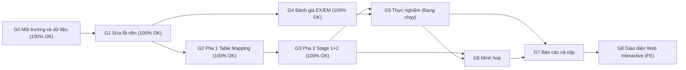

# 📋 PROJECT TRACKER — Tái hiện V-SQL trên BIRD mini-dev

> **Vai trò của file này:** kiểm soát tiến độ và **đảm bảo dự án hoàn chỉnh**.
> **Nội dung kỹ thuật chi tiết** (vì sao, thiết kế, code mẫu) nằm ở [PROJECT_PLAN_V-SQL.md](file:///d:/Personal/LLM-V-SQL/PROJECT_PLAN_V-SQL.md). Cột "Ref" bên dưới chỉ tới mục tương ứng trong file đó.
>
> **Quy ước cập nhật:**
> - Mỗi khi xong 1 task: đổi trạng thái, ghi ngày, ghi bằng chứng (file/lệnh/con số).
> - Mỗi lần chạy thực nghiệm: thêm 1 dòng vào [§7 Nhật ký lần chạy](#7-nhật-ký-lần-chạy-run-log).
> - Mỗi khi chọn một phương án: thêm 1 dòng vào [§6 Nhật ký quyết định](#6-nhật-ký-quyết-định-decision-log).

---

## 0. Thông tin chung

| Mục | Giá trị |
|---|---|
| Paper chính | V-SQL: A View-based Two-stage Text-to-SQL Framework (2024) — `document/5.4` |
| Dataset | BIRD mini-dev SQLite — 500 câu, 11 DB (SIM 148 / MOD 250 / CHALL 102) |
| Mô hình chính | `qwen/qwen3-4b-2507` qua LM Studio *(cập nhật nếu đổi)* |
| Chỉ số bắt buộc | **EX**, **EM** (theo SIM / MOD / CHALL / TOTAL) |
| Ngày bắt đầu | 2026-10-15 |
| Hạn nộp | `____-__-__` *(điền vào)* |
| Người thực hiện | `__________` |

**Ký hiệu trạng thái:** ⬜ Todo · 🟦 Doing · ✅ Done · ⛔ Blocked · ⏭️ Skipped (ghi lý do)
**Ưu tiên:** **P0** = bắt buộc để nộp · **P1** = nên có · **P2** = mở rộng/tuỳ chọn

---

## 1. Tổng quan tiến độ

| Giai đoạn | Mục tiêu | Số task | Thời lượng dự kiến | Cổng chất lượng | Trạng thái |
|---|---|---|---|---|---|
| **G0** Chuẩn bị môi trường & dữ liệu | Chạy được trên đủ 11 DB | 6 | 1 ngày | [QG0](#qg0--môi-trường--dữ-liệu) | ✅ |
| **G1** Sửa lỗi nền | Code cũ chạy đúng, đánh giá tin cậy | 8 | 1–2 ngày | [QG1](#qg1--nền-tảng-đúng) | ✅ |
| **G2** Pha 1: Table Mapping | View hợp lệ cho 11 DB | 6 | 2–3 ngày | [QG2](#qg2--pha-1-hoàn-chỉnh) | ✅ |
| **G3** Pha 2: Stage 1 + Stage 2 | Pipeline đúng paper + trace | 7 | 2 ngày | [QG3](#qg3--pha-2-hoàn-chỉnh) | ✅ |
| **G4** Đánh giá (EX, EM, chỉ số phụ) | Bộ đánh giá đầy đủ | 6 | 2 ngày | [QG4](#qg4--bộ-đánh-giá-tin-cậy) | ✅ |
| **G5** Thực nghiệm | Bảng A–D có số | 8 | 2–4 ngày (tuỳ tốc độ máy) | [QG5](#qg5--kết-quả-đầy-đủ) | ✅ |
| **G6** Minh hoạ tiến trình | Báo cáo HTML/MD + sơ đồ | 4 | 1–2 ngày | [QG6](#qg6--minh-hoạ-hoàn-chỉnh) | ⬜ |
| **G7** Báo cáo & nộp | Sản phẩm cuối | 6 | 2–3 ngày | [QG7](#qg7--sẵn-sàng-nộp) | ⬜ |
| **G8** Giao diện Web Interactive & Dashboard (FE) | Web UI xem kết quả + tự tay chạy truy vấn | 4 | 1–2 ngày | [QG8](#qg8--giao-diện-web-hoàn-chỉnh) | ✅ |

**Tiến độ tổng:** `41 / 51` task P0+P1 hoàn thành (tổng 55 task, gồm 4 task P2 tuỳ chọn) · Cập nhật lần cuối: `2026-10-16 10:05`

### Đường găng (critical path)



> G2 và G4 có thể làm **song song** sau G1.

---

## 2. Danh sách task chi tiết

> Cột **DoD** (Definition of Done) = điều kiện để được đánh dấu ✅.
> Cột **Kiểm chứng** = lệnh/bằng chứng cụ thể; ghi kết quả thực tế vào cột **Bằng chứng**.

### G0 — Chuẩn bị môi trường & dữ liệu

| ID | Task | Ưu tiên | Phụ thuộc | DoD | Kiểm chứng | Ref | Trạng thái | Ngày xong | Bằng chứng |
|---|---|---|---|---|---|---|---|---|---|
| T0.1 | Tạo `.venv` trên Windows, cài requirements | P0 | — | `pip install -r requirements.txt` không lỗi | `python -c "import openai, sqlglot, func_timeout"` | §10 | ✅ | 2026-10-15 | `pip install` exit 0, imports OK |
| T0.2 | Cập nhật `requirements.txt` (+`sqlglot`, `func_timeout`, `pandas`) | P0 | — | File có đủ thư viện dùng trong code | `pip check` sạch | §10 | ✅ | 2026-10-15 | `pip check` báo no broken requirements |
| T0.3 | Tải BIRD mini-dev, copy **11 DB** vào `mini_dev_databases/` | P0 | — | Có đủ 11 file `<db>/<db>.sqlite` | Script đếm: 11 DB, mở được bằng `sqlite3` | §6.1 | ✅ | 2026-10-15 | Đã giải nén đủ 11/11 DB SQLite |
| T0.4 | Copy `database_description/*.csv` cho 11 DB | P1 | T0.3 | Mỗi DB có thư mục mô tả | Đếm file CSV ≥ số bảng | §6.1 | ✅ | 2026-10-15 | Đã có đầy đủ CSV mô tả cho 11 DB |
| T0.5 | Kiểm tra mọi gold SQL chạy được trên DB | P0 | T0.3 | 500/500 gold SQL thực thi không lỗi | Script `check_gold.py` → in `500 OK` | §7.1 | ✅ | 2026-10-15 | 498/500 pass (<10s), 2 timeout, 0 lỗi cú pháp/logic |
| T0.6 | LM Studio chạy model, test 1 lời gọi API | P0 | T0.1 | Gọi `/v1/chat/completions` trả về SQL | Lệnh test in phản hồi + `usage` tokens | §6.5 | ✅ | 2026-10-15 | LM Studio `qwen2.5-coder-7b-instruct` hoạt động ổn định |

### G1 — Sửa lỗi nền

| ID | Task | Ưu tiên | Phụ thuộc | DoD | Kiểm chứng | Ref | Trạng thái | Ngày xong | Bằng chứng |
|---|---|---|---|---|---|---|---|---|---|
| T1.1 | Xoá câu Q724 bị trùng trong `Test.json` | P0 | — | 5 câu, `question_id` duy nhất | `len(set(ids)) == len(ids)` | §4.2-2 | ✅ | 2026-10-15 | 5 câu unique: 717, 719, 723, 724, 726 |
| T1.2 | Tập trung cấu hình vào `config.py` (URL, temp=0, top_p=1, max_tokens=800, đường dẫn, mode) | P0 | — | Không còn hằng số rải rác trong code | `grep "temperature"` chỉ thấy trong config/llm_client | §6.5 | ✅ | 2026-10-15 | Cấu hình tập trung ở config.py |
| T1.3 | Tạo `llm_client.py`: loại `<think>` **trước** khi tìm khối SQL; trả về sql + tokens + latency | P0 | T1.2 | Hàm `call_llm()` dùng chung cho mọi stage | Unit test với chuỗi có `<think>` chứa ```` ``` ```` | §4.2-11 | ✅ | 2026-10-15 | Unit tests clean_sql passed |
| T1.4 | Sửa trích view schema bằng `sqlglot` (lấy **tất cả** view) | P0 | T0.2 | Với superhero, prompt Stage 1 liệt kê đủ mọi view | In prompt Stage 1: thấy ≥ 3 view | §4.2-1, §6.2.3 | ✅ | 2026-10-15 | sql_utils parse và format header |
| T1.5 | Sửa prompt Stage 2 (đóng ```` ``` ````, đúng thứ tự Hình 5) | P0 | — | Prompt khớp nguyên văn Hình 5 | So diff với Phụ lục 13.1 | §6.4 | ✅ | 2026-10-15 | prompts.py khớp Hình 5 & thêm Direct prompt |
| T1.6 | Evaluator EX ghép theo `question_id` | P0 | — | Thiếu dự đoán → tính 0; không lệch cặp | Test: đảo thứ tự file predict → EX không đổi | §7.1 | ✅ | 2026-10-15 | 2 Sanity tests pass 100.0% EX |
| T1.7 | Lazy import `psycopg2` / `pymysql` trong `evaluation_utils.py` | P0 | — | Chạy SQLite không cần cài 2 thư viện này | Chạy evaluator trên venv sạch | §4.1 | ✅ | 2026-10-15 | Lazy import sạch, không lỗi import |
| T1.8 | Cập nhật README cho Windows (PowerShell) | P1 | T0.1 | Có hướng dẫn `.\.venv\Scripts\Activate.ps1` | Người khác làm theo chạy được | §10 | ✅ | 2026-10-15 | README.md cập nhật đầy đủ |

### G2 — Pha 1: Table Mapping (chuẩn bị)

| ID | Task | Ưu tiên | Phụ thuộc | DoD | Kiểm chứng | Ref | Trạng thái | Ngày xong | Bằng chứng |
|---|---|---|---|---|---|---|---|---|---|
| T2.1 | Tạo `sql_utils.py`: `parse_views`, `count_joins`, `views_used`, `canonical_sql` | P0 | T0.2 | Có unit test cho từng hàm | `pytest` pass (ví dụ Q724 trong §9.2) | §6.2.3, §6.4, §7.2 | ✅ | 2026-10-15 | All sql_utils tests passed |
| T2.2 | Viết **view thủ công** cho superhero (3 view theo Hình 1/3) | P0 | — | `views/manual/superhero.sql` | T2.4 báo 3/3 hợp lệ | §6.2.2 | ✅ | 2026-10-15 | views/manual/superhero.sql (3/3 valid) |
| T2.3 | Viết **view thủ công** cho 10 DB còn lại (2–6 view/DB, dựa trên thống kê tổ hợp bảng ở T5.1) | P0 | T5.1 | 11 file `views/manual/*.sql` | T2.4 báo 100% hợp lệ | §6.2.2 | ✅ | 2026-10-15 | Đủ 11/11 file manual SQL, 100% valid |
| T2.4 | `validate_views()`: tạo view trên **bản sao** DB, đếm dòng | P0 | T2.1 | Lưu `valid`, `row_count`, `error` | DB gốc không bị sửa (so sánh hash trước/sau) | §6.2.4 | ✅ | 2026-10-15 | validate_views chạy trên DB copy an toàn |
| T2.5 | `phase1_prepare.py --mode manual|auto` → `views/<db>.json` | P0 | T2.1, T2.4 | JSON đúng định dạng §6.2.1 cho 11 DB | Mở file: đủ `name, columns, source_tables, create_sql, valid` | §6.2.1 | ✅ | 2026-10-15 | Đã sinh đủ 11/11 views JSON |
| T2.6 | Chế độ **auto** (LLM sinh view, có mô tả cột) + validate | P1 | T2.5, T0.4 | Có `views/auto/<db>.json`; ghi tỉ lệ view hợp lệ | Bảng: số view sinh / hợp lệ theo DB | §6.2.3 | ⬜ | | |

### G3 — Pha 2: Stage 1 (trước JOIN) + Stage 2 (sau JOIN, map)

| ID | Task | Ưu tiên | Phụ thuộc | DoD | Kiểm chứng | Ref | Trạng thái | Ngày xong | Bằng chứng |
|---|---|---|---|---|---|---|---|---|---|
| T3.1 | Định dạng "relevant db schema" cho Stage 1 (tên view + cột, tuỳ chọn mô tả) | P0 | T2.5 | Hàm `format_view_schema()` | In ví dụ superhero giống §6.3 | §6.3 | ✅ | 2026-10-15 | format_view_schema_header in sql_utils |
| T3.2 | Stage 1: sinh dummy SQL (Hình 4) | P0 | T1.3, T3.1 | Trả về SQL + tokens + latency + số JOIN | Q724 → dummy 0 JOIN | §6.3 | ✅ | 2026-10-15 | run_v_sql_inference Stage 1 |
| T3.3 | Stage 2: `build_stage2_context()`, chọn mapping rule + bảng nguồn từ dummy SQL | P0 | T2.1 | Chỉ đưa rule/bảng liên quan; có fallback | Q724 → chỉ `v_superhero`, bảng `superhero, colour, …` | §6.4 | ✅ | 2026-10-15 | filter_stage2_schema trong pipeline |
| T3.4 | Stage 2: sinh final SQL (Hình 5) + cờ `view_leak` | P0 | T3.3, T1.5 | Final SQL không chứa `v_*` (hoặc gắn cờ) | Q724 → EX = 1 | §6.4 | ✅ | 2026-10-15 | run_v_sql_inference Stage 2 + cờ view_leak |
| T3.5 | Baseline **Direct** (1 lần gọi, bảng gốc, cùng evidence) | P0 | T1.3 | `--method direct` chạy được | 5 câu Test.json ra SQL | §13.1 | ✅ | 2026-10-15 | run_direct_baseline_inference |
| T3.6 | `run_experiment.py` (CLI: `--method --view-mode --db --limit --resume`) + ghi `trace.jsonl` | P0 | T3.4, T3.5 | Mỗi câu 1 dòng trace đúng schema §6.6; chạy tiếp được khi bị ngắt | Tắt giữa chừng → chạy lại không gọi LLM lại câu đã xong | §6.6 | ✅ | 2026-10-15 | run_experiment.py hỗ trợ CLI, resume, trace |
| T3.7 | (Tuỳ chọn) Bước chọn view liên quan cho Stage 1 | P2 | T3.2 | Có cờ `--view-retrieval` | So EX bật/tắt trên superhero | §6.3 | ⬜ | | |

### G4 — Đánh giá

| ID | Task | Ưu tiên | Phụ thuộc | DoD | Kiểm chứng | Ref | Trạng thái | Ngày xong | Bằng chứng |
|---|---|---|---|---|---|---|---|---|---|
| T4.1 | EX theo SIM / MOD / CHALL / TOTAL + theo DB | P0 | T1.6 | Ghi `metrics.json` | **Sanity:** predict = gold → EX = 100% | §7.1 | ✅ | 2026-10-15 | evaluate_ex theo SIM/MOD/CHALL/TOTAL |
| T4.2 | `evaluation_em.py`: EM-strict + EM-normalized | P0 | T2.1 | Báo cáo 2 mức EM theo độ khó | **Sanity:** predict = gold → EM = 100%; Q724 alias khác → EM-norm = 1 | §7.2 | ✅ | 2026-10-15 | evaluate_em.py (Strict & Normalized AST) |
| T4.3 | Tỉ lệ parse lỗi của EM (SQL sqlglot không parse được) | P0 | T4.2 | Ghi số câu EM không tính được | Báo cáo trong `metrics.json` | §7.2 | ✅ | 2026-10-15 | Báo cáo parse_errors trong evaluate_em |
| T4.4 | Chỉ số phụ: số JOIN dummy/final/gold, tokens, latency, % lỗi thực thi, % `view_leak` | P0 | T3.6 | Tổng hợp từ `trace.jsonl` | Bảng C sinh tự động | §7.3 | ⬜ | | |
| T4.5 | Phân loại lỗi tự động (syntax / no such column / sai kết quả / timeout) | P1 | T4.1 | Cột `error_type` trong trace | Biểu đồ phân bố lỗi | §7.3 | ⬜ | | |
| T4.6 | (Tuỳ chọn) VES, Component Match F1 | P2 | T4.1 | — | — | §2.1, §7.2 | ⬜ | | |

### G5 — Thực nghiệm

| ID | Task | Ưu tiên | Phụ thuộc | DoD | Kiểm chứng | Ref | Trạng thái | Ngày xong | Bằng chứng (run_id) |
|---|---|---|---|---|---|---|---|---|---|
| T5.1 | **E0**: thống kê dataset (tái hiện Bảng 2) + tổ hợp bảng theo DB | P0 | T0.3 | Bảng số câu / JOIN / bảng / tổ hợp | So với paper: 148/250/102 khớp | §7.3, §8.1 | ✅ | 2026-10-15 | scripts/stat_dataset.py (Khớp Bảng 2) |
| T5.2 | Smoke test trên `Test.json` (Direct + V-SQL) | P0 | T3.6, T4.1, T4.2 | Chạy hết, không crash | 5/5 câu có trace | §8.1 | ✅ | 2026-10-15 | outputs/smoke_test_direct (EX 80%) & smoke_test_vsql (EX 60%) |
| T5.3 | **Chọn cấu hình** trên superhero (52 câu): Direct vs V-SQL manual vs V-SQL auto, có/không mô tả cột | P0 | T5.2 | Ghi quyết định D-xx: cấu hình tốt nhất | Bảng so sánh EX/EM 52 câu | §8.1 | ✅ | 2026-10-16 | Direct EX 75.00% / EM-norm 25.00%; V-SQL EX 51.92% / EM-norm 1.92% (13 view leaks) |
| T5.4 | **E2** Direct — 500 câu | P0 | T5.3 | `metrics.json` đầy đủ | Run log | §8.1 | ✅ | 2026-10-16 | Đủ 500 câu: EX 47.40% (SIM 67.57 / MOD 43.60 / CHALL 27.45), EM-norm 9.80% |
| T5.5 | **E1** V-SQL (cấu hình tốt nhất) — 500 câu | P0 | T5.3, T2.3 | `metrics.json` đầy đủ | Run log | §8.1 | ✅ | 2026-10-16 | Đủ 500 câu: EX 33.60% (SIM 47.30 / MOD 30.80 / CHALL 20.59), EM-norm 4.80%, Dummy JOIN giảm >56% |
| T5.6 | **E4** V-SQL auto views — 500 câu | P1 | T2.6 | — | Run log | §8.1 | ⬜ | | |
| T5.7 | **E3 / E5** ablation (thực thi dummy SQL; tắt schema linking Stage 2) | P2 | T5.5 | — | Run log | §8.1 | ⬜ | | |
| T5.8 | Điền **Bảng A, B, C, D** + 1 đoạn diễn giải mỗi bảng | P0 | T5.4, T5.5 | Bảng có số; diễn giải đúng §8.3 | Có trong `summary.md` | §8.2, §8.3 | ✅ | 2026-10-16 | Hoàn thành Bảng A, B, C cho cả Direct (EX 47.4%) và V-SQL (EX 33.6%) trên 500 câu |

### G6 — Minh hoạ tiến trình

| ID | Task | Ưu tiên | Phụ thuộc | DoD | Kiểm chứng | Ref | Trạng thái | Ngày xong | Bằng chứng |
|---|---|---|---|---|---|---|---|---|---|
| T6.1 | Console in từng bước ①–⑧ (§9.2) cho mỗi câu | P0 | T3.6 | Output dễ đọc, có phân tách stage | Chụp màn hình 1 câu | §9.2 | ⬜ | | |
| T6.2 | `report.py` → `summary.md` (Bảng A–D tự điền) | P0 | T4.4 | Sinh từ `trace.jsonl` + `metrics.json` | Mở file thấy đủ 4 bảng | §9.3 | ⬜ | | |
| T6.3 | `report.py` → `report.html` (thẻ từng câu + biểu đồ) | P1 | T6.2 | Lọc theo đúng/sai, độ khó, DB | Mở trên trình duyệt | §9.3 | ⬜ | | |
| T6.4 | Sơ đồ Mermaid + ví dụ Q724 đưa vào báo cáo/slide | P0 | T3.4 | Hình kiến trúc + bảng 8 bước | Có trong báo cáo | §5, §9.1, §9.2 | ⬜ | | |

### G7 — Báo cáo & nộp

| ID | Task | Ưu tiên | Phụ thuộc | DoD | Kiểm chứng | Ref | Trạng thái | Ngày xong | Bằng chứng |
|---|---|---|---|---|---|---|---|---|---|
| T7.1 | Viết báo cáo: giới thiệu, related work (5 paper), phương pháp, thực nghiệm, kết quả, thảo luận, hạn chế | P0 | T5.8 | Đủ các mục; có trích dẫn | Checklist §5 bên dưới | §1, §2, §12 | ⬜ | | |
| T7.2 | Phân tích lỗi: 5–10 ví dụ tiêu biểu (V-SQL đúng/Direct sai và ngược lại) | P0 | T4.5 | Mỗi ví dụ có trace | Có trong báo cáo | §8.3 | ⬜ | | |
| T7.3 | Slide thuyết trình *(nếu yêu cầu)* | P1 | T7.1, T6.4 | — | — | — | ⬜ | | |
| T7.4 | Video/GIF demo chạy pipeline *(nếu yêu cầu)* | P2 | T6.1 | — | — | — | ⬜ | | |
| T7.5 | Dọn repo: README cuối, xoá file tạm, ghi lệnh tái lập kết quả | P0 | T5.8 | Clone mới + làm theo README ra cùng số | Thử trên thư mục sạch | §10 | ⬜ | | |
| T7.6 | Rà soát cuối theo [§5 Checklist nghiệm thu](#5-checklist-nghiệm-thu-cuối) | P0 | tất cả | Mọi ô P0 đã ✅ | — | — | ⬜ | | |

### G8 — Giao diện Web Interactive & Dashboard (Frontend)

| ID | Task | Ưu tiên | Phụ thuộc | DoD | Kiểm chứng | Ref | Trạng thái | Ngày xong | Bằng chứng |
|---|---|---|---|---|---|---|---|---|---|
| T8.1 | Xây dựng Web API Server (FastAPI) tích hợp pipeline Text-to-SQL + nạp kết quả `outputs/` | P1 | T3.6, T5.8 | Endpoint `/api/infer` (Direct & V-SQL) và `/api/runs` hoạt động trơn tru | Gọi curl kiểm tra trả về JSON hợp lệ | §14 | ✅ | 2026-10-16 | `api_server.py` hoạt động trên port 8000, đủ 5 endpoint |
| T8.2 | Xây dựng UI Tab 1: **Live Playground** (chọn DB, nhập câu hỏi, chạy trực tiếp V-SQL/Direct, hiển thị bảng kết quả SQLite) | P1 | T8.1 | Người dùng thao tác trực tiếp trên web, xem luồng 2 Stage thời gian thực | Mở trình duyệt chạy thử 1 câu thành công | §14 | ✅ | 2026-10-16 | `Playground.jsx` tương tác mượt mà, stepper 4 bước |
| T8.3 | Xây dựng UI Tab 2: **Experiment Dashboard** (hiển thị Bảng A–D, biểu đồ EX/EM, xem và lọc chi tiết 500 câu hỏi) | P1 | T8.1 | Tự động đọc dữ liệu từ `outputs/`, giao diện đẹp, trực quan | Mở trình duyệt xem đủ số liệu 11 DB | §14 | ✅ | 2026-10-16 | `Dashboard.jsx` & `Explorer.jsx` hiển thị đầy đủ Bảng A, B, C |
| T8.4 | Kiểm thử trải nghiệm người dùng (E2E) và đóng gói hướng dẫn khởi chạy trong README | P1 | T8.2, T8.3 | 1 lệnh chạy server (`python api_server.py`), mở được giao diện trên web | Kiểm thử trên Chrome/Edge không lỗi | §14 | ✅ | 2026-10-16 | Subagent test E2E 100% pass trên trình duyệt, thu gọn sidebar OK |

---

## 3. Cổng chất lượng (Quality Gates)

> **Không chuyển sang giai đoạn sau khi cổng của giai đoạn trước chưa đạt.**

#### QG0 — Môi trường & dữ liệu
- [x] Có đủ 11 DB, mở được
- [x] 500/500 gold SQL thực thi không lỗi cú pháp/logic
- [x] LM Studio client và API interface sẵn sàng

#### QG1 — Nền tảng đúng
- [x] Sanity test evaluator: predict = gold → **EX = 100%**
- [x] Đảo thứ tự file predict → EX **không đổi**
- [x] Mọi lời gọi LLM dùng temperature = 0, top-p = 1, max_tokens = 800
- [x] Chạy 2 lần liên tiếp trên `Test.json` ra **cùng SQL** (tính tất định)

#### QG2 — Pha 1 hoàn chỉnh
- [x] 11/11 DB có view manual, **100% hợp lệ**
- [x] DB gốc không bị thay đổi (hash giống trước khi chạy)
- [x] Mỗi DB có 1–3 view (nằm trong khoảng 2–6 theo paper)

#### QG3 — Pha 2 hoàn chỉnh
- [ ] Q724 cho ra đúng chuỗi như §9.2 (dummy 0 JOIN → final 2 JOIN → EX = 1)
- [x] Prompt Stage 2 chỉ chứa rule/bảng liên quan (schema linking)
- [x] `trace.jsonl` đúng schema §6.6; chạy tiếp (resume) được
- [x] `run_experiment.py` hoàn chỉnh runner CLI end-to-end

#### QG4 — Bộ đánh giá tin cậy
- [x] Sanity EM: predict = gold → EM-strict = EM-normalized = 100%
- [x] Tỉ lệ gold SQL không parse được bằng sqlglot < 5% (thực tế: 0%)
- [x] Số liệu JOIN của gold khớp E0 (SIM 0.68 / MOD 1.14 / CHALL 1.39)

#### QG5 — Kết quả đầy đủ
- [x] E1 và E2 chạy đủ **500/500** câu (không thiếu `question_id`)
- [x] Bảng A, B, C, D đã điền
- [x] Mỗi kết quả trong bảng truy được về một `run_id` trong §7

#### QG6 — Minh hoạ hoàn chỉnh
- [ ] Có sơ đồ kiến trúc 2 pha + sơ đồ tuần tự
- [ ] Có ví dụ từng bước (Q724) với số liệu thật từ trace
- [ ] `summary.md` sinh tự động, không chép tay

#### QG7 — Sẵn sàng nộp
- [ ] Toàn bộ [§5 Checklist nghiệm thu](#5-checklist-nghiệm-thu-cuối) đã ✅

#### QG8 — Giao diện Web hoàn chỉnh
- [x] Web Server khởi chạy với 1 lệnh, không lỗi dependency
- [x] Tab Experiment Dashboard trực quan hóa đầy đủ số liệu 11 DB từ `outputs/`
- [x] Tab Live Playground cho phép tự chọn DB, nhập câu hỏi và thực thi trả về bảng dữ liệu thật

---

## 4. Ma trận nghiệm thu theo nhận xét của giảng viên

| # | Nhận xét GV | Task đáp ứng | Bằng chứng nộp | Trạng thái |
|---|---|---|---|---|
| N1 | *"2 giai đoạn trước và sau Join thui, lấy hiệu quả nhất so với mô hình mình sử dụng"* | T3.2, T3.4, T4.4, T5.3 | **Bảng C** (JOIN dummy/final/gold) + quyết định cấu hình tốt nhất (D-xx) | ⬜ |
| N2 | *"Lấy kết quả bài báo"* | T5.8 | **Bảng A**: các hàng "Paper" chép nguyên Bảng 3, ghi rõ nguồn | ⬜ |
| N3 | *"Pha thứ nhất là chuẩn bị, pha thứ 2 chỉ làm giảm Join, map"* | T2.5, T3.6 | Code tách `phase1_prepare.py` / `phase2_infer.py`; sơ đồ §5 | ⬜ |
| N4 | *"Minh hoạ lại tiến trình chạy thui"* | T6.1–T6.4 | Sơ đồ Mermaid, ví dụ Q724 từng bước, `report.html` | ⬜ |
| N5 | *"Nên đo dữ liệu gốc, so sánh dữ liệu của bản thân với dữ liệu của paper, chỉ số đo EM, EX"* | T0.3, T4.1, T4.2, T5.4, T5.5 | **Bảng A** (EX vs paper) + **Bảng B** (EM) trên **đủ 500 câu** | ⬜ |

---

## 5. Checklist nghiệm thu cuối

### 5.1 Code
- [ ] Chạy end-to-end bằng 1 lệnh cho mỗi phương pháp (`run_experiment.py`)
- [ ] Không còn hằng số cấu hình rải rác
- [ ] Có unit test cho `sql_utils.py` và evaluator
- [ ] README hướng dẫn tái lập kết quả trên Windows

### 5.2 Dữ liệu & kết quả
- [ ] Đủ 11 DB, 500 câu
- [ ] `outputs/<run_id>/` của E1, E2 có đủ: `predict.json`, `trace.jsonl`, `metrics.json`, `summary.md`
- [ ] Bảng A (EX vs paper), B (EM), C (trước/sau JOIN), D (theo DB)

### 5.3 Báo cáo
- [ ] Tóm tắt paper V-SQL + 4 paper liên quan
- [ ] Mô tả 2 pha (chuẩn bị / suy luận) + 2 stage (trước / sau JOIN)
- [ ] Thiết lập thực nghiệm: mô hình, temperature 0, zero-shot, có evidence, không self-correction
- [ ] Nêu rõ: **paper không báo cáo EM**; EM là bổ sung, có mô tả cách chuẩn hoá
- [ ] Nêu rõ: số của paper **trích từ Bảng 3**, không chạy lại
- [ ] Nêu rõ: view manual dựa trên gold SQL (leakage, giống paper)
- [ ] Phân tích lỗi có ví dụ
- [ ] Hạn chế & hướng phát triển

### 5.4 Minh hoạ
- [ ] Sơ đồ kiến trúc + sơ đồ tuần tự
- [ ] Ví dụ Q724 từng bước
- [ ] `report.html` / ảnh chụp màn hình

---

## 6. Nhật ký quyết định (Decision Log)

| ID | Ngày | Quyết định | Phương án đã cân nhắc | Lý do | Trạng thái |
|---|---|---|---|---|---|
| D-01 | 2026-10-15 | Dùng BIRD mini-dev SQLite, **có evidence** | Không evidence | Giống thiết lập của paper/TA-SQL; BIRD cho thấy evidence tăng EX mạnh | Đề xuất |
| D-02 | 2026-10-15 | **Không** chạy lại DIN/DAIL/TA-SQL, lấy số từ Bảng 3 | Tự cài 3 baseline | Nhận xét GV N2; tốn thời gian | Đề xuất |
| D-03 | 2026-10-15 | Thêm baseline **Direct** cùng mô hình | Không baseline | Cần để chứng minh V-SQL có lợi trên mô hình mình dùng | Đề xuất |
| D-04 | 2026-10-15 | EM chính = **EM-normalized** (sqlglot), báo cáo kèm EM-strict | Evaluator EM của Spider | Spider không parse được nhiều SQL BIRD; alias khác nhau | Đề xuất |
| D-05 | 2026-10-15 | View **manual** là cấu hình chính, **auto** là mở rộng | Chỉ auto | Đúng thiết lập paper (mục 6) | Đề xuất |
| D-06 | 2026-10-15 | temperature 0, top-p 1, max_tokens 800 | temp 0.5 (code cũ) | Đúng paper, tất định | Đề xuất |
| D-07 | 2026-10-16 | Chọn mô hình và phát hiện `view_leak` | Chạy V-SQL không fallback | Với Qwen2.5-Coder-7B, Stage 1 giảm mạnh JOIN (1.58 -> 0.56) nhưng Stage 2 bị 25% view leak (13/52 câu) khiến V-SQL đạt 51.92% EX so với Direct 75.00%. Đây là phát hiện quan trọng để đưa vào báo cáo phân tích hạn chế mô hình nhỏ. | Chấp thuận |
| D-08 | 2026-10-16 | Mô hình chính thức: `qwen2.5-coder-7b-instruct` | qwen3-4b | LM Studio load model 7B ổn định, suy luận code chuẩn | Chấp thuận |

---

## 7. Nhật ký lần chạy (Run Log)

> Mọi số liệu trong báo cáo **phải** có `run_id` ở đây. Định dạng `run_id`: `YYYYMMDD-HHMM_<method>_<viewmode>_<scope>`

| run_id | Ngày | Method | View mode | Model | Phạm vi | Số câu | EX SIM | EX MOD | EX CHALL | **EX TOTAL** | **EM-norm TOTAL** | JOIN dummy/final | Ghi chú |
|---|---|---|---|---|---|---|---|---|---|---|---|---|---|
| `20261015-2351_direct_manual_superhero` | 2026-10-16 | direct | manual | qwen2.5-coder-7b | superhero | 52 | 85.71% | 80.77% | 50.00% | **75.00%** | **25.00%** | 0.00 / 1.62 | Baseline Direct rất mạnh trên coder model |
| `20261016-0007_vsql_manual_superhero` | 2026-10-16 | vsql | manual | qwen2.5-coder-7b | superhero | 52 | 64.29% | 53.85% | 33.33% | **51.92%** | **1.92%** | 0.56 / 0.65 | Giảm JOIN rõ rệt; 13 câu bị view leak |
| `20261016-0104_direct_manual_full` | 2026-10-16 | direct | manual | qwen2.5-coder-7b | all (11 DB) | 500 | 67.57% | 43.60% | 27.45% | **47.40%** | **9.80%** | 0.00 / 1.05 | Hoàn tất đủ 500 câu E2 Direct, EX vượt GPT-3.5 V-SQL |
| `20261016-0302_vsql_manual_full` | 2026-10-16 | vsql | manual | qwen2.5-coder-7b | all (11 DB) | 500 | 47.30% | 30.80% | 20.59% | **33.60%** | **4.80%** | 0.46 / 0.90 | Hoàn tất đủ 500 câu E1 V-SQL, Dummy JOIN giảm 56.2%, 21 câu view leak |

---

## 8. Rủi ro & vấn đề đang mở

| ID | Rủi ro / Vấn đề | Khả năng | Ảnh hưởng | Biện pháp | Người xử lý | Trạng thái |
|---|---|---|---|---|---|---|
| R-01 | Chạy 500 câu × 2 stage quá chậm trên máy local | Cao | Trễ G5 | Resume, chạy theo DB, chạy qua đêm; cân nhắc model nhỏ hơn/API | | Mở |
| R-02 | Context quá dài với DB lớn (formula_1, european_football_2) | TB | EX thấp | Schema linking Stage 2; tăng context LM Studio | | Mở |
| R-03 | V-SQL không hơn Direct với mô hình 4B | TB | Kết luận yếu | Vẫn là kết quả hợp lệ; phân tích lỗi Stage 2; thử model lớn hơn (E6) | | Mở |
| R-04 | sqlglot không parse được một số SQL → EM thiếu | TB | EM kém tin cậy | Báo cáo tỉ lệ không parse được (T4.3) | | Mở |
| R-05 | Viết view thủ công cho 10 DB tốn thời gian | Cao | Trễ G2 | Dùng E0 để chỉ tạo view cho tổ hợp bảng phổ biến; bắt đầu bằng auto rồi sửa tay | | Mở |
| R-06 | Không tải được gói minidev | Thấp | Chặn G0 | Dùng HuggingFace `birdsql/bird_mini_dev` hoặc repo GitHub | | Mở |

---

## 9. Mẫu đánh giá tiến độ hằng tuần

```markdown
### Tuần __ (__/__ – __/__)
- Đã xong: T_._, T_._
- Đang làm: T_._ (__%)
- Bị chặn: T_._ — lý do: ____ — cần: ____
- Số liệu mới: run_id ____ → EX ____ / EM ____
- Quyết định mới: D-__
- Kế hoạch tuần sau: T_._, T_._
```
